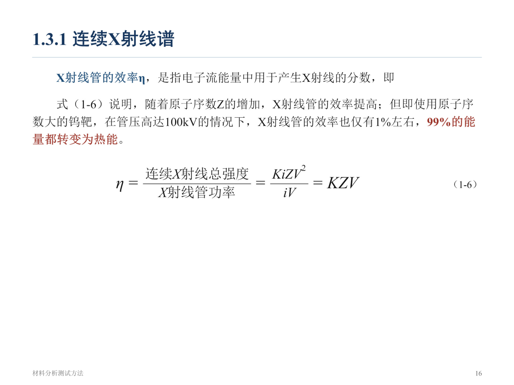
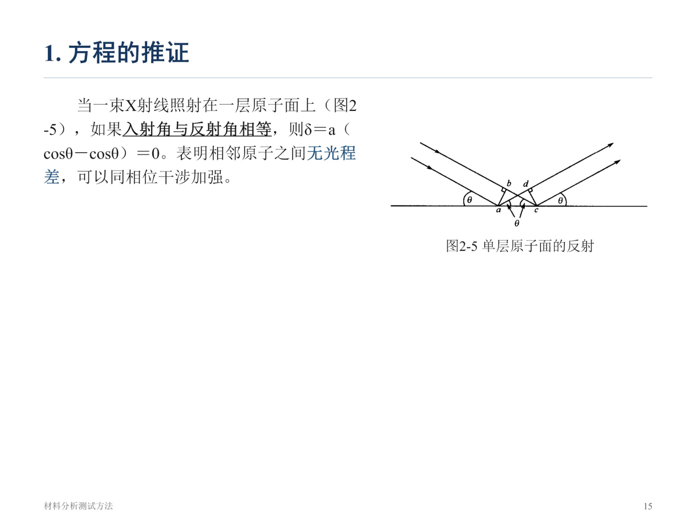
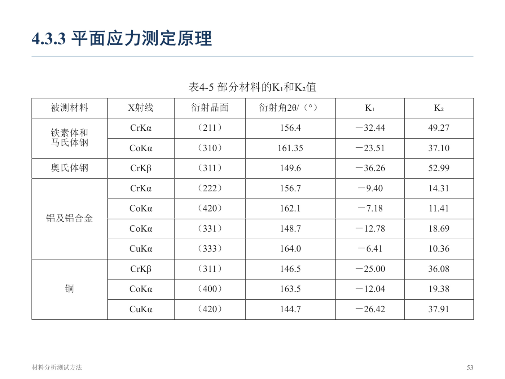
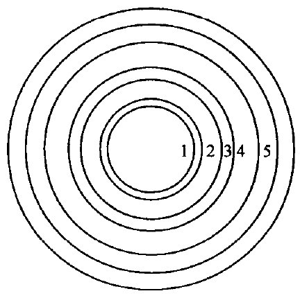
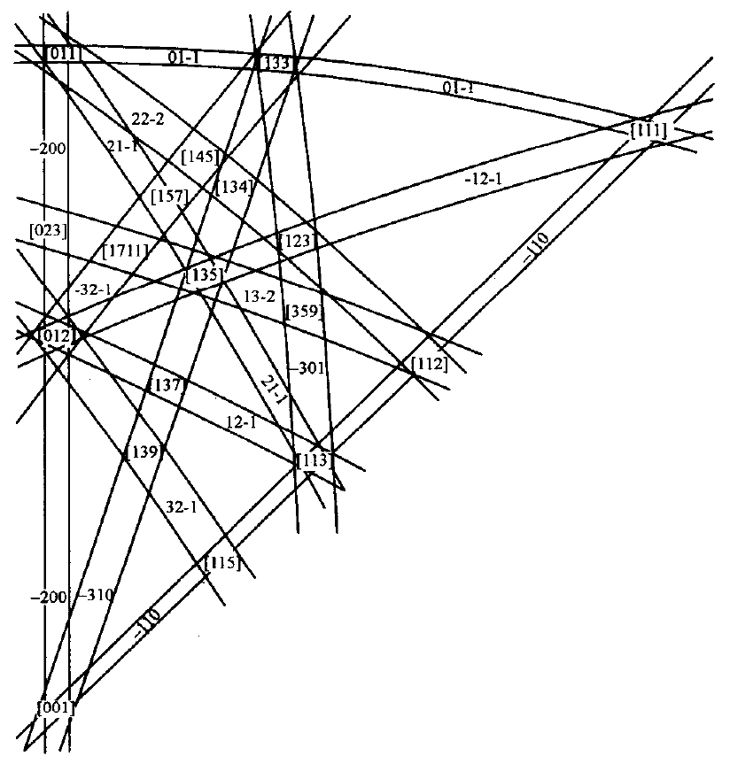
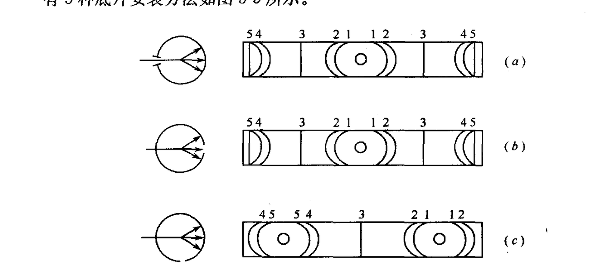
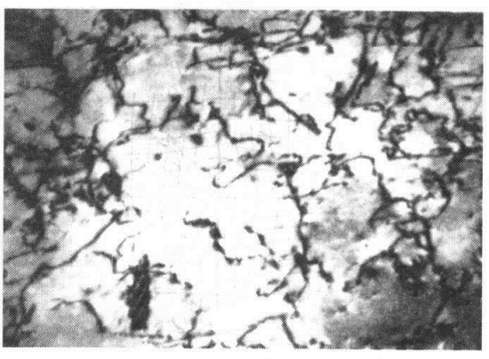
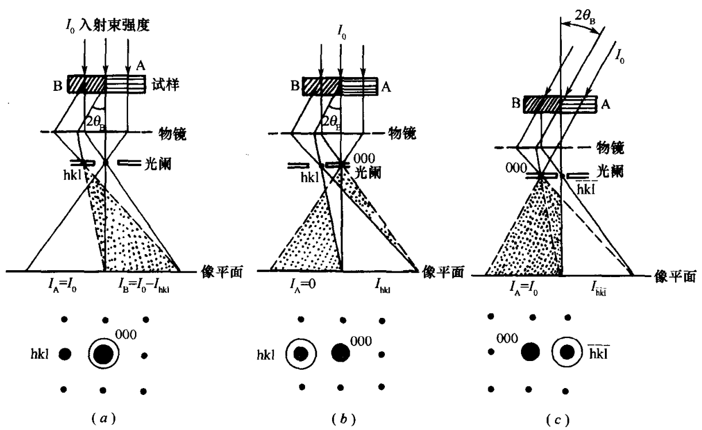
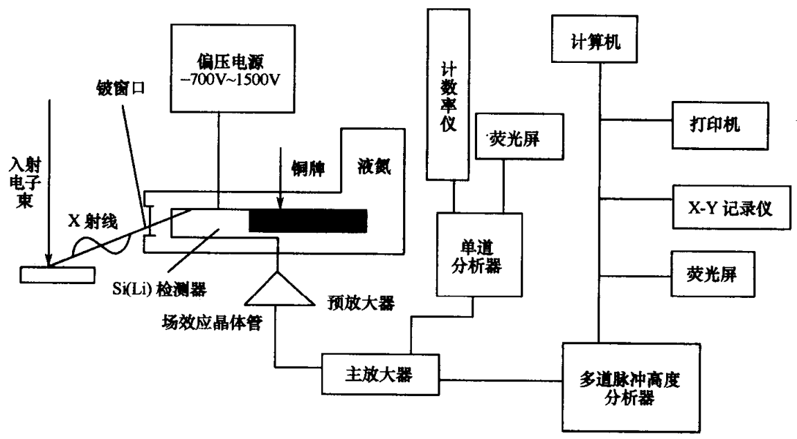

# 效果展示

用一份真实的**材料分析测试方法课程课件（10 章 694 页 PPT，含大量公式与图表）**跑完整个流程。下面是各环节的实际结果。

## 对照一：公式密集页

原页面里，公式由几十个独立文本框和线条拼成——直接提取文字只能得到一串散落的字符，分式结构、上下标、希腊字母全部丢失。

**原始 PPT 页面：**



**提取输出**（Markdown，公式可渲染）：

```markdown
$$
I _ {c} = K i Z V ^ {m}\tag{1-5}
$$

X射线管的效率 $\eta$ ，是指电子流能量中用于产生X射线的分数，即

式（1-6）说明，随着原子序数Z的增加，X射线管的效率提高；但即使用原子序数大的钨靶，
在管压高达100kV的情况下，X射线管的效率也仅有 $1\%$ 左右， $99\%$ 的能量都转变为热能。

$$
\eta = \frac {\text{连续} X \text{射线总强度}}{X \text{射线管功率}}
= \frac {K i Z V ^ {2}}{i V} = K Z V\tag{1-6}
$$
```

注意分母里的中文：OCR 原始输出用的是 `\mathrm{连续}`，KaTeX 会告警且渲染不齐，归一化后改为 `\text{连续}`。公式编号 `\tag{1-6}` 保留，因为正文里"式（1-6）说明…"需要它。

## 对照二：跨片段括号

原课件里有一种奇怪写法——**左括号在正文、右括号落在公式内**。OCR 会照抄，导致公式自身括号不配平。

**原始 PPT 页面：**



**提取输出**：

```markdown
当一束X射线照射在一层原子面上（图2-5），如果入射角与反射角相等，
则 $\delta = a$ （ $\cos \theta - \cos \theta$） = 0 。表明相邻原子之间无光程差，可以同相位干涉加强。
```

括号被还原到正文侧，行内公式保持配平。这个问题在交付校验里会被单独检查。

## 对照三：复杂分式与偏导数

**原始 PPT 页面：**



**提取输出**：

```markdown
$$
\varepsilon_ {\psi} = \frac {\Delta d}{d} = \frac {d _ {\psi} - d _ {0}}{d _ {0}}
= - \cot \theta_ {0} (\theta_ {\psi} - \theta_ {0})\tag{4-33}
$$

$$
\sigma_ {\varphi} = - \frac {E}{2 (1 + \nu)} \cot \theta_ {0}
\frac {\partial (2 \theta)}{\partial (\sin^ {2} \psi)}\tag{4-35}
$$

式（4-35）中的 $2 \theta$ 以弧度为单位。当以度为单位时，上式则为

$$
\sigma_ {\varphi} = - \frac {E}{2 (1 + v)} \cot \theta_ {0} \frac {\pi}{1 8 0 ^ {\circ}}
\frac {\partial (2 \theta)}{\partial (\sin^ {2} \psi)}\tag{4-36}
$$
```

嵌套分式、偏导数、希腊字母全部还原。

## 图片提取质量

图片优先取 **PPT 内嵌原图**（原始分辨率），而不是截取 PDF 页面。

**衍射标定图**（结晶学指数标注清晰可读）：



**菊池图**（大量精细线条，截图会糊掉）：



**仪器结构示意图：**



**显微图像**（保留原始灰度层次）：



**原理示意图：**

| 衍衬衬度成像原理 | 扫描电镜信号 |
| --- | --- |
|  |  |

## 用源文件校正 OCR 错字

源文件是 PPTX 时，按文本框坐标 + 文本相似度配对，用原生文字纠正 OCR。实际结果：**2118 个公式位置中，900 多处文字与源文件逐字一致，7 处自动纠正，14 处列出待人工确认**。

自动纠正的真实例子：

| OCR 识别 | 源文件（正确） | 错误类型 |
| --- | --- | --- |
| 韧致辐射 | 轫致辐射 | 同音字 |
| 频率为 v 的电磁波 | 频率为 ν 的电磁波 | 希腊字母误识 |
| No 为阿伏加德罗常数 | N₀ 为阿伏加德罗常数 | 下标丢失 |

## 去重与清理

**同一张图重复出现只保留一次**：PPT 里讲师常把同一张图放在连续多页讲解，按内容哈希去重后从 264 处降到 **199 张**。

**图内标签不重复成正文**：OCR 会把画在图片上的标签（如"透射波""(a)"）识别成独立文字块。判断文字块是否落在图片区域内，是则丢弃——图片本身已包含这些标签。

## 最终校验结果

```
状态：pass
文档 11 篇，图片 199 张，公式 2118 个，共 241001 字符

公式编译校验：总数 2118，通过 2118，失败 0
浏览器渲染：12 张图全部加载，85 个公式渲染成功，0 报错
```

三项检查覆盖不同层面：

| 检查 | 脚本 | 覆盖内容 |
| --- | --- | --- |
| 结构校验 | `validate_output.py` | 标题层级、图片引用、失效链接、编辑痕迹残留 |
| 公式编译 | `validate_math.cjs` | KaTeX 逐个编译全部公式，要求 100% 通过 |
| 实际渲染 | `preview_server.py` | 浏览器里图片与公式的真实显示效果 |

## 为什么需要浏览器实渲

实测遇到过一个**纯文本检查完全看不出、但渲染必然出错**的 bug：图注里含公式定界符会破坏 image 标签。

```markdown
<!-- 错误：$ 破坏了 image 语法，图片不显示 -->


<!-- 正确：图注转纯文本 -->

```

Markdown 解析器把 `$` 当普通字符，正则检查也不报错，只有浏览器里才发现图片挂掉。所以图注、标题、alt 文本一律不含 `$`、`\`、`{}`、`*`。

## 处理规模

| 指标 | 数值 |
| --- | --- |
| 文档页数 | 694 |
| 输出字符 | 241,001 |
| 独立公式块 | 339 |
| 行内公式 | 1779 |
| 图片 | 199 |
| 表格 | 36 |
| OCR 耗时 | 十几分钟（云端） |
| 交付体积 | 24 MB |

---

*示例数据来自一份材料分析测试方法课程课件的真实处理结果。出于版权考虑，此仓库不分发原始课件，仅展示处理技术细节与少量示意图。*
