# 文献精读：碳包覆 Ni/NiOx 光热助催化剂中受阻路易斯酸碱对（FLPs）协同增强光催化产氢

> **原文定位**：[[Yang 等 - 2024 - Unveiling the Synergistic Role of Frustrated Lewis Pairs in Carbon-Encapsulated Ni_NiOx Photothermal|主文 Markdown 知识库]] · [DOI: 10.1002/adma.202313513](https://doi.org/10.1002/adma.202313513) · Zotero: `3XGQUZAW`  
> **精读依据**：已完整核对 Advanced Materials 正式主文（11 页）及全部 53 页 Supporting Information（SI Fast-Probe 穿透提取 36 幅附图、4 张附表与实验计算方法）。  
> **阅读交互**：正文图表引用采用 **双链悬停气泡预览（`↗`）** 与 **文末折叠抽屉（`[!example]-`）** 双重模式，既可在阅读时悬停即览原图，也可点击展开深入核对图谱细节。

---

## 1. 核心结论与创新点（Executive Summary）

### 1.1 核心科学问题
半导体光催化水分解面临光生电子-空穴超快复合及界面水解离/产氢动力学迟缓的双重瓶颈。贵金属 Pt 助催化剂成本高昂，而传统非贵金属（如单质 Ni、NiO 或过渡金属复合物）在界面往往缺乏高效活化水分子 H–OH 键并同时降低氢吸脱附自由能的活性位点。如何打破经典的键合限制，在低成本异质界面上原位构筑**高密度、近邻且稳定的受阻路易斯酸碱对（Frustrated Lewis Pairs, FLPs）**，是该领域的长期挑战。

### 1.2 关键突破与结论
1. **姜-泰勒（Jahn–Teller）效应原位驱动双极性点缺陷**：首次发现在溶胶-凝胶衍生碳包覆 $\mathrm{Ni/NiO_x}$（$\mathrm{Ni/NiO_x@C}$）的晶界形成过程中，Jahn–Teller 效应驱动了局部晶格畸变，自发诱导生成高密度的正电性氧空位（$\mathrm{V_O}$）与负电性镍空位（$\mathrm{V_{Ni}}$）。
2. **空间近邻 FLPs 的电子极化与协同水解离**：$\mathrm{V_O}$ 与碳骨架结合形成富电子的路易斯碱性位点（$\mathrm{FLP\text{-}V_O\text{-}C}$），而 $\mathrm{V_{Ni}}$ 与碳结合形成缺电子的路易斯酸性位点（$\mathrm{FLP\text{-}V_{Ni}\text{-}C}$）。两者空间相邻但由于电子不对称与几何受阻不发生湮灭，协同极化水分子：$\mathrm{FLP\text{-}V_{Ni}\text{-}C}$ 强吸附水分子的氧端（$\mathrm{OH}^\delta-$），$\mathrm{FLP\text{-}V_O\text{-}C}$ 极化质子端（$\mathrm{H}^\delta+$），使水分子初始解离能垒显著降低。
3. **光热-光催化强协同效应**：碳层包覆与异质晶界缺陷态引起的非辐射弛豫带来显著的光热效应。在全光谱模拟日光下使反应体系产生微区温升（升温至 36.76 °C，强光下可达 128.1 °C），有效降低产氢表观活化能（$E_a$ 从 28.5 降至 16.4 kJ/mol），并抑制光生载流子复合。
4. **创纪录的催化性能**：负载 5 wt% $\mathrm{Ni/NiO_x@C}$ 的 $\mathrm{g\text{-}C_3N_4}$（样品编号 **NOCC5**）在 10 vol% 三乙醇胺（TEOA）水溶液中，光催化产氢速率达到 **$10.71\ \mathrm{mmol\cdot g^{-1}\cdot h^{-1}}$**（$10710\ \mathrm{\mu mol\cdot g^{-1}\cdot h^{-1}}$），是商用 1.0 wt% $\mathrm{Pt/g\text{-}C_3N_4}$（$6.07\ \mathrm{mmol\cdot g^{-1}\cdot h^{-1}}$）的 **1.76 倍**；在 380 nm 处的表观量子产率（AQY）高达 **40.78%**，刷新了同类镍基助催化剂的纪录。

---

## 2. 实验复现 SOP 与关键配方卡（Replication Protocol）

本配方卡由正文及 53 页 SI（SI Fast-Probe 检索 p.2–4, p.34）提取汇编，供实验室人员精准复现：

| 实验阶段                      | 试剂与设备                                                | 精确用量 / 配比                                                                                            | 工艺程序与操作要点                                                                                         | 关键参数与质量控制                                                                                              |
| :------------------------ | :--------------------------------------------------- | :--------------------------------------------------------------------------------------------------- | :------------------------------------------------------------------------------------------------ | :----------------------------------------------------------------------------------------------------- |
| **Step 1: 前驱体溶胶制备**       | 醋酸镍四水合物<br>柠檬酸<br>超纯水 / 无水乙醇                         | $\mathrm{Ni(CH_3COO)_2\cdot 4H_2O}$：0.4 g<br>柠檬酸（$\mathrm{C_6H_8O_7}$）：1.0 g<br>水 2.5 mL + 乙醇 1.0 mL | 磁力搅拌至完全溶解呈翠绿色透明溶液，转移至瓷舟，放入烘箱 80 °C 干燥 3 h 形成三维膨胀海绵状凝胶前驱体。                                         | 严控镍/柠檬酸质量比 1:2.5；若溶剂挥发过快会导致凝胶不均。                                                                       |
| **Step 2: 气氛煅烧与相工程**      | 管式炉（高纯 Ar 气氛）<br>瓷舟                                  | 干燥后的凝胶前驱体全量                                                                                          | 通 Ar 吹扫排空空气（30 min）；以 5 °C/min 升温至 **400 °C 恒温碳化 8 h**；随炉自然冷却至室温。产物标记为 **NOC400**。                | 400 °C 为形成 $\mathrm{Ni/NiO}$ 异质结与最高密度空位（$\mathrm{V_O/V_{Ni}}$）的临界窗口，低于 350 °C 无金属 Ni，高于 450 °C 晶粒严重粗化。 |
| **Step 3: 基体催化剂制备**       | 工业尿素<br>马弗炉（空气）                                      | 尿素粉末：40.0 g<br>带盖坩埚                                                                                  | 置于带盖瓷坩埚中，马弗炉以 10 °C/min 升温至 600 °C 煅烧 2 h；冷却后加入热水和去离子水抽滤洗涤 3 次，60 °C 干燥后充分玛瑙研磨。                   | 产物为浅黄色多孔蜂窝状 $\mathrm{g\text{-}C_3N_4}$ 粉末，禁带宽度 $E_g = 2.7\ \mathrm{eV}$。                               |
| **Step 4: 纳米级装配 (NOCC5)** | NOC400 助催化剂<br>$\mathrm{g\text{-}C_3N_4}$ 粉末<br>无水乙醇 | $\mathrm{g\text{-}C_3N_4}$：100 mg (0.1 g)<br>NOC400：5.26 mg（折合 5.0 wt%）<br>乙醇：5 mL + 1 mL            | 将两者加入 5 mL 乙醇冰水浴超声分散 2 h；离心收集后冷冻干燥；再加入 1 mL 乙醇在玛瑙研钵中机械强力研磨 1 h，干燥过筛备用。                            | 超声+研磨复合分散法是确保 5 nm 核壳粒子与氮化碳紧密非共价贴合的关键。                                                                 |
| **Step 5: 光催化产氢评价**       | 顶照石英反应池<br>300 W 氙灯 (AM 1.5)<br>在线气相色谱 (GC)          | 催化剂：10.0 mg<br>去离子水：90 mL<br>三乙醇胺 (TEOA)：10 mL（10 vol%）                                              | 悬浮液超声 10 min 分散均匀；安装密封系统，真空泵抽真空 30 min 彻底排净溶解空气；开启冷凝循环水（控温 25 °C）；开启 AM 1.5 光照，GC 每隔 1 h 取样分析产氢量。 | TEOA 必须新鲜避光；若测试光热协同，需对比移除循环水时的自然升温曲线。                                                                  |
| **Step 6: FTO薄膜光电制备**     | FTO 导电玻璃（1×2 cm）<br>Nafion 溶液 (0.5 wt%)              | 催化剂粉末：5.0 mg<br>Nafion：100 μL<br>无水乙醇：900 μL                                                         | 超声 60 min 得均一墨水；均匀滴涂于 FTO 导电面上，置于烘箱 80 °C 烘烤 12 h 固化。在 10 vol% TEOA 电解液中测光电流与阻抗。                  | 膜厚度保持均匀，阻抗测试偏压设为开路电位。                                                                                  |

> **⚠️ 复现注意与已知缺口（Limitations）**：
> 1. **保护气氛控制**：管式炉退火过程中微量漏氧会直接导致还原态金属 Ni 重新氧化为纯相 NiO，丧失双相异质界面；
> 2. **降温速率未公开**：原文未指明 400 °C 恒温 8 h 后的降温速率（默认自然降温），骤冷或缓冷可能对 Jahn-Teller 晶格畸变的冻结产生影响；
> 3. **牺牲剂依赖**：本体系必须加入 10 vol% TEOA，非纯水全解水反应，不可遗漏牺牲剂。

---

## 3. 反应机理与电荷动力学流程（Mermaid 原生渲染）

以下根据论文能带对齐（Figure 6a）与 FLPs 协同活化水分子过程（Figure 6b）绘制机理图：

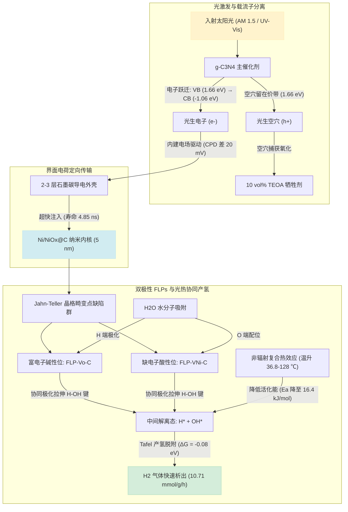

---

## 4. 结构表征与微观证据链（证据溯源与图文对照）

作者构建了从宏观物相到原子尺度缺陷的完整证据链（对应 [[Yang 等 - 2024 - Unveiling the Synergistic Role of Frustrated Lewis Pairs in Carbon-Encapsulated Ni_NiOx Photothermal#^fig1|Figure 1 ↗]] 与 [[Yang 等 - 2024 - Unveiling the Synergistic Role of Frustrated Lewis Pairs in Carbon-Encapsulated Ni_NiOx Photothermal#^fig2|Figure 2 ↗]]）：

### 4.1 晶相演变 ([[Yang 等 - 2024 - Unveiling the Synergistic Role of Frustrated Lewis Pairs in Carbon-Encapsulated Ni_NiOx Photothermal#^fig1|Figure 1b ↗]])
- **300 °C (OC300)**：仅出现石墨碳 C (200) 与立方相 NiO（JCPDS No. 47-1049）衍射峰；
- **350 °C (NOC350) 与 400 °C (NOC400)**：出现金属 Ni (111) 与 (200) 晶面衍射峰（JCPDS No. 04-0850），表明柠檬酸碳化生成的碳骨架在热力学上部分还原了 NiO，形成 $\mathrm{Ni/NiO_x}$ 多相异质界面；
- **450 °C (NC450)**：NiO 衍射峰进一步减弱，金属 Ni 晶粒粗化，催化活性随之下降。

> [!tip]- 🔍 精准子图切片：Figure 1b（XRD 随退火温度演变谱）
> 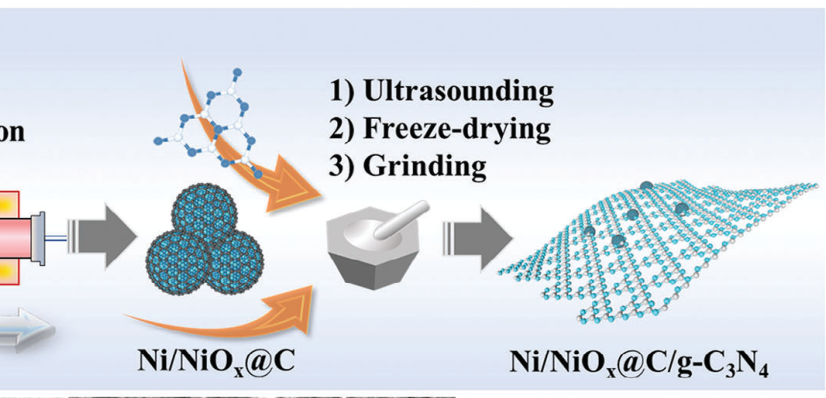
> *看点说明：清晰展示 400 °C 时双相重叠衍射峰，证实异质相变临界点。*

### 4.2 球差电镜与原子级缺陷 ([[Yang 等 - 2024 - Unveiling the Synergistic Role of Frustrated Lewis Pairs in Carbon-Encapsulated Ni_NiOx Photothermal#^fig1|Figure 1c–e & Figure S4 ↗]])
- **HRTEM 观测**：超细 $\mathrm{Ni/NiO_x}$ 纳米晶粒（平均粒径约 5 nm）被 2–3 层少层碳层紧密包裹，呈石榴状超结构；
- **晶格间距**：测得 0.208 nm 对应 NiO (200) 晶面，0.203 nm 对应金属 Ni (111) 晶面；
- **球差校正 HAADF-STEM**：在 $\mathrm{Ni/NiO}$ 晶界处清晰观测到大量暗原子空位（深蓝标记）与晶格边缘位错（浅蓝标记），表明存在强烈的局域晶格畸变。

> [!tip]- 🔍 精准子图切片：Figure 1e 与 SI 附图 Figure S4（球差电镜原子缺陷与空位）
> 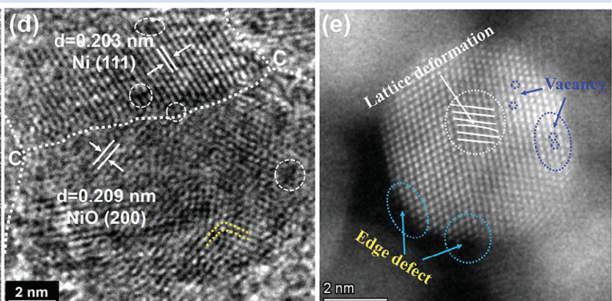
> 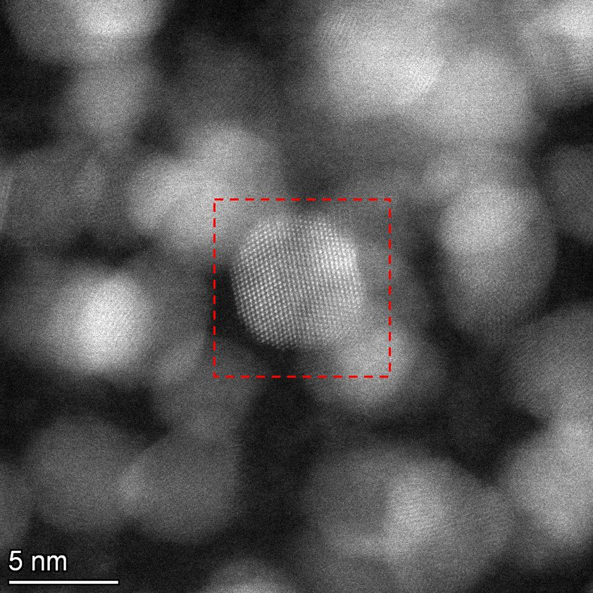
> *看点说明：白色虚线圈出区域为晶界交错的高密度原子点缺陷群；Figure S4 提供了更大视场的局域晶格条纹位错。*

> [!example]- 📷 点击展开全景对照图表：Figure 1（制备流程、XRD 演变与微观球差结构）
> 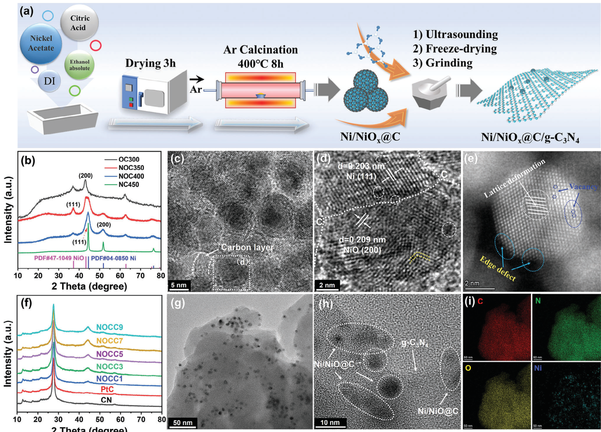
> **图表对照要点**：
> 1. 查看面板 (b) 的 XRD 演变：400 °C 退火时刚好处于 NiO 峰衰减与金属 Ni 峰萌生的双晶相共存交汇点；
> 2. 查看面板 (e) 的球差 HAADF-STEM 像：白色虚线圈出区域为晶界交错的高密度原子点缺陷群；
> 3. 查看面板 (g-i) 的 EDS Mapping：证实碳骨架完整包裹在金属-氧化物内核外部。

---

### 4.3 缺陷类型与电子顺磁共振 ([[Yang 等 - 2024 - Unveiling the Synergistic Role of Frustrated Lewis Pairs in Carbon-Encapsulated Ni_NiOx Photothermal#^fig2|Figure 2d,e ↗]])
- **氧空位（$\mathrm{V_O}$）**：在 $g = 2.003$ 处出现强自由电子共振信号，NOC400 浓度为 $1.595\times 10^{14}\ \mathrm{spins\cdot mm^{-3}}$；
- **镍空位（$\mathrm{V_{Ni}}$）**：在 $g = 2.21$ 处出现特征信号，归属于未成对 d 电子捕获局域空穴态形成的镍空位，NOC400 浓度为 $5.870\times 10^{12}\ \mathrm{spins\cdot mm^{-3}}$；
- 证明 400 °C 退火处于金属-氧化物部分相转变的动态临界点，此时 Jahn–Teller 效应诱发的空位密度与相对比例（$\mathrm{V_{Ni}/V_O} = 0.037$）最适中。

> [!tip]- 🔍 精准子图切片：Figure 2d,e 与 2f（EPR 自旋共振信号与 XAS 吸收边）
> 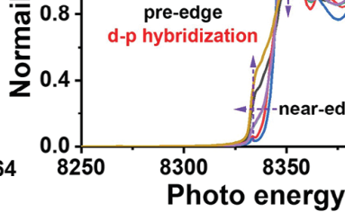
> 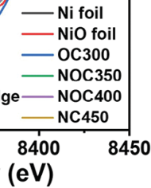
> *看点说明：$g=2.003$（氧空位）与 $g=2.21$（镍空位）的对称峰位，是证明双极性酸碱活性位点的直接自旋物理依据。*

### 4.4 同步辐射 X 射线吸收谱 ([[Yang 等 - 2024 - Unveiling the Synergistic Role of Frustrated Lewis Pairs in Carbon-Encapsulated Ni_NiOx Photothermal#^fig2|Figure 2f & Figure S14–S17 ↗]])
- **XANES 吸收边**：NOC400 的吸收边能量介于 Ni 箔与 NiO 箔之间，证实 Ni 的平均价态处于不饱和混合价态（$\mathrm{Ni^\delta+}$）；
- **EXAFS 径向配位（R 空间）**：第一配位层 Ni–O（1.6 Å）和 Ni–Ni（2.2 Å、2.6 Å）的特征峰强度大幅衰减，配位数远低于标准 Ni 箔（12）和 NiO 箔（6），定量证实高密度 $\mathrm{V_{Ni}}$ 和 $\mathrm{V_O}$ 使晶格处于高度配位不饱和状态。

> [!example]- 📷 点击展开全景对照图表：Figure 2（XPS 表面价态、EPR 缺陷自旋定量与 XAS 谱学）
> 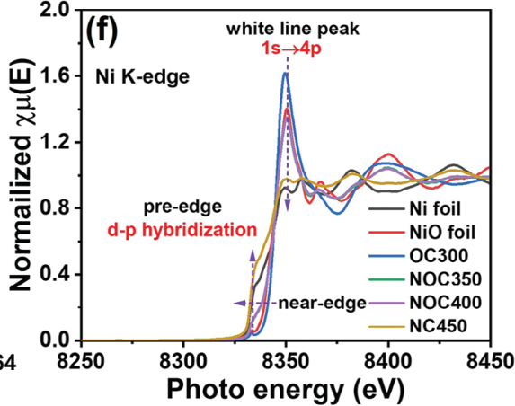
> **图表对照要点**：
> 1. 面板 (b) 的 O 1s 与面板 (c) 的 Ni 2p：通过低自旋 $\mathrm{Ni^{3+}}$ 与 $\mathrm{V_O}$ 拟合峰证实晶界处双重缺陷存在；
> 2. 面板 (d,e) 的定量 EPR：$g=2.003$ 与 $g=2.21$ 的对称峰位是双极性酸碱活性位点的关键判据；
> 3. 面板 (f) 的 Ni K-edge XANES：白线峰（white line）强度随还原温度升高而连续减弱，反映 d 轨道电子填充变化。

---

## 5. 光热协同与动力学加速（Figure 3 & Figure 4）

### 5.1 光吸收与光热温升特性 ([[Yang 等 - 2024 - Unveiling the Synergistic Role of Frustrated Lewis Pairs in Carbon-Encapsulated Ni_NiOx Photothermal#^fig3|Figure 3a,d,e ↗]])
- **UV-vis DRS（Figure 3a）**：黑色 $\mathrm{Ni/NiO_x@C}$ 具备全谱强吸收，复合后在 200–800 nm 及近红外区光吸收大幅度跃升，吸收边保持在 460 nm（$E_g \approx 2.7\ \mathrm{eV}$）；
- **红外热成像（Figure 3d,e）**：在模拟太阳光照射 40 min 后，NOCC5 反应悬浮液温度升至 36.76 °C，比纯 $\mathrm{g\text{-}C_3N_4}$ 高出 5.55 °C；干粉强光下可激增至 128.1–157.9 °C（Figure S21）。

### 5.2 抑制载流子复合动力学 ([[Yang 等 - 2024 - Unveiling the Synergistic Role of Frustrated Lewis Pairs in Carbon-Encapsulated Ni_NiOx Photothermal#^fig3|Figure 3c,f,g ↗]])
- **时间分辨荧光（TRPL, Figure 3c）**：NOCC5 的平均寿命 $\tau_A = 4.85\ \mathrm{ns}$，较纯氮化碳（5.74 ns）和 PtC（6.67 ns）大幅压缩，非辐射衰减振幅 $A_1$ 占优，证实光生电子迅速注入助催化剂；
- **变温荧光猝灭（Figure 3f,g）**：随着温度升高，PL 发生热猝灭，表明热场能辅助束缚态载流子翻越陷阱势垒，向反应活性位转移。

> [!example]- 📷 点击展开对照图表：Figure 3（全波段吸收、瞬态荧光衰减与红外热成像）
> 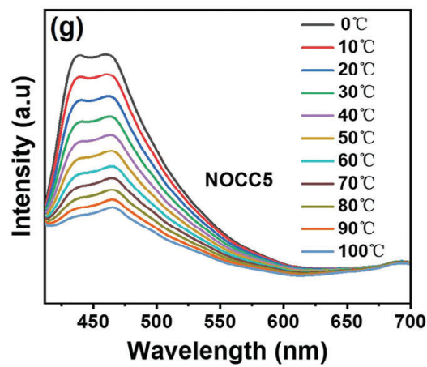
> **图表对照要点**：
> 1. 面板 (a)：注意观察 500–800 nm 尾部吸收，NOCC5 呈现出明显的非线性“黑色吸光体”上翘；
> 2. 面板 (d,e)：红外热像图中反应池液面呈现清晰的明亮热汇集区（36.76 °C）；
> 3. 面板 (f,g)：对比纯氮化碳与 NOCC5 的变温荧光曲线，验证热场对电子-空穴复合的抑制。

---

### 5.3 界面电位与表观活化能降低 ([[Yang 等 - 2024 - Unveiling the Synergistic Role of Frustrated Lewis Pairs in Carbon-Encapsulated Ni_NiOx Photothermal#^fig4|Figure 4a–i ↗]])
- **开尔文探针力显微镜（KPFM）**：表面电位图（Figure 4b,c）显示 $\mathrm{Ni/NiO_x@C}$ 相对 $\mathrm{g\text{-}C_3N_4}$ 存在 10–20 mV 的负向接触电位差（CPD），微观直接证实内建电场驱动电子从氮化碳向助催化剂转移；
- **Arrhenius 活化能拟合**：测得产氢活化能 $E_a$ 从纯 $\mathrm{g\text{-}C_3N_4}$ 的 $28.5\ \mathrm{kJ\cdot mol^{-1}}$ 骤降至 **$16.4\ \mathrm{kJ\cdot mol^{-1}}$**；
- **表观量子效率（AQY）**：380 nm 处达 40.78%，420 nm 处达 11.2%，与吸光特性严密吻合。

> [!tip]- 🔍 精准子图切片：Figure 4f、4h 与 4i（产氢活性、活化能拟合与 AQY）
> 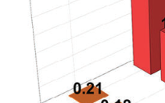
> 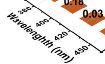
> 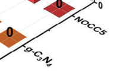
> *看点说明：(f) 显示 NOCC5 产氢活性达到 10.71 mmol/g/h（超越 PtC 1.76 倍）；(h) 阿伦尼乌斯斜率平缓化对应 Ea 降低 42.5%；(i) 380 nm 处 AQY 达到 40.78%。*

> [!example]- 📷 点击展开全景对照图表：Figure 4（KPFM 功函数阶跃、催化产氢性能、Arrhenius 曲线与 AQY）
> 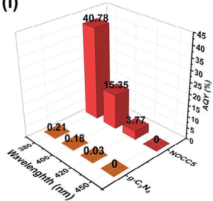
> **图表对照要点**：
> 1. 面板 (d,e)：KPFM 跨异质界面线扫电位突降，是证实界面载流子自发迁移的直接物理证据；
> 2. 面板 (f)：NOCC5 产氢速率（10.71 mmol/g/h）明显碾压对比样品及 1 wt% PtC（6.07 mmol/g/h）；
> 3. 面板 (h)：阿伦尼乌斯拟合直线斜率明显变平缓，定量印证活化能降低了 42.5%。

---

## 6. DFT 理论计算与水分子协同活化（Figure 5 & Figure 6）

### 6.1 差分电荷密度与 FLPs 极化模型 ([[Yang 等 - 2024 - Unveiling the Synergistic Role of Frustrated Lewis Pairs in Carbon-Encapsulated Ni_NiOx Photothermal#^fig5|Figure 5c ↗]])
- 计算体系：VASP，PAW-PBE，GGA+U（Ni 的 $U = 6.45\ \mathrm{eV}$）；
- 在 $\mathrm{Defect\text{-}Ni/NiO/Graphite}$ 体系中，$\mathrm{V_{Ni}}$ 与 $\mathrm{V_O}$ 造成晶格原子缺失，激发周围碳环 $\pi$ 电子轨道发生自旋不对称极化，形成相反指向的电子云分布：
  * $\mathrm{FLP\text{-}V_O\text{-}C}$ 表现为向上突出的富电子云，充当 Lewis 碱；
  * $\mathrm{FLP\text{-}V_{Ni}\text{-}C}$ 表现为向下凹陷的缺电子云，充当 Lewis 酸；
  * 两者受碳刚性骨架支撑，保持近邻但不发生空间中和。

### 6.2 反应自由能与水解离能垒降解 ([[Yang 等 - 2024 - Unveiling the Synergistic Role of Frustrated Lewis Pairs in Carbon-Encapsulated Ni_NiOx Photothermal#^fig5|Figure 5a,b ↗]])
- **Volmer 解离步骤**：水分子吸附解离能垒从完整异质界面的 2.46 eV 降低至 2.20 eV，水分子发生剧烈双向电荷极化拉伸；
- **Tafel 析氢步骤**：氢吸附自由能 $\Delta G_{\mathrm{H^*}}$ 从 $+1.50\ \mathrm{eV}$（弱物理吸附）优化至 **$-0.08\ \mathrm{eV}$**（极度接近 0 eV 的 Sabatier 理想热中性点）。

> [!example]- 📷 点击展开对照图表：Figure 5 与 Figure 6（DFT 反应势垒、差分电荷极化与全景机理）
> 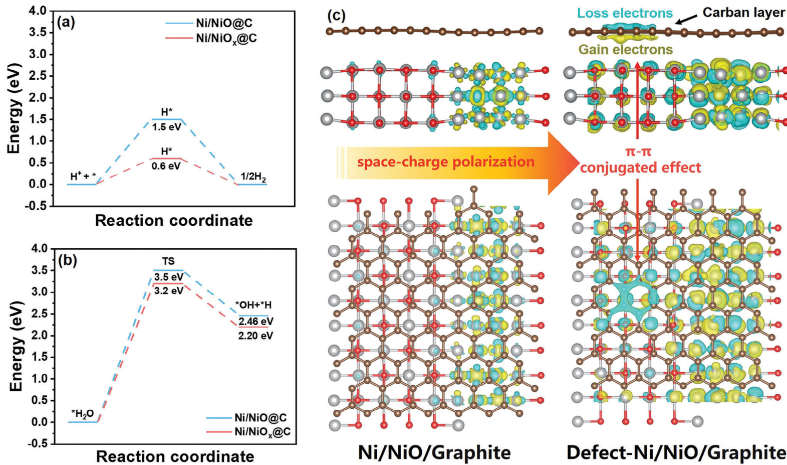
> 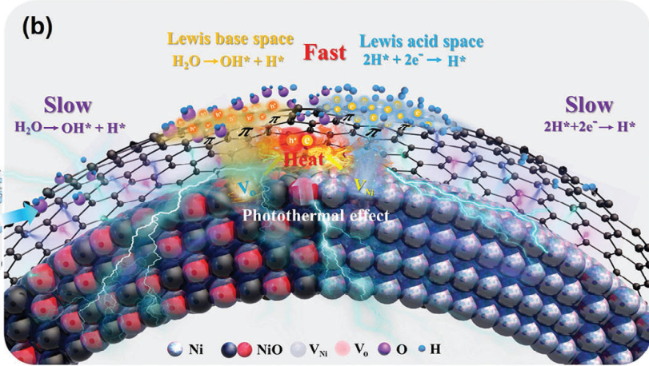
> **图表对照要点**：
> 1. Figure 5c：黄色为电子积聚，青色为电子消耗，清晰展示石墨碳层在空位影响下的双极性电荷交替重排；
> 2. Figure 6b：全景示意水分子被酸碱双活性位点“钳形捕获”并协同劈开释放氢气的微观物理图像。

---

## 7. SI 补充材料定向透视（SI Fast-Probe 提取对比）

通过 `si_probe.py` 定向透视 53 页 SI，提取出关键的横向对比数据（Table S3）：

| 序号 | 催化体系 | 光源功率与滤波波长 | 牺牲剂类型与浓度 | 产氢速率 ($\mu\mathrm{mol\cdot g^{-1}\cdot h^{-1}}$) | AQY 表观量子效率 | 文献出处 |
| :---: | :--- | :--- | :--- | :---: | :---: | :---: |
| **1** | **$\mathrm{Ni/NiO_x@C / g\text{-}C_3N_4}$ (NOCC5)** | **300W Xe, AM 1.5** | **10 vol% TEOA** | **10,710** | **40.78% (380 nm)** | **This work** |
| 2 | $\mathrm{Ni / g\text{-}C_3N_4}$ | 300W Xe, AM 1.5 | 30 vol% TEOA | 5,809 | 0.12% (400 nm) | Chem. Eng. J. 2021 |
| 3 | $\mathrm{Ni@C / g\text{-}C_3N_4}$ | 300W Xe, $\lambda > 420\ \mathrm{nm}$ | 10 vol% TEOA | 2,151 | 未报告 | Appl. Catal. B 2020 |
| 4 | $\mathrm{NiO / g\text{-}C_3N_4}$ | 300W Xe, $\lambda > 420\ \mathrm{nm}$ | 10 vol% TEOA | 68.8 | 0.01% (500 nm) | ACS Catal. 2019 |
| 5 | $\mathrm{CuNi@C{=}O / g\text{-}C_3N_4}$ | 300W Xe, $\lambda > 400\ \mathrm{nm}$ | 15 vol% TEOA | 2,360 | 10.22% (420 nm) | Small 2022 |
| 6 | $\mathrm{NiO/Ni_2P / g\text{-}C_3N_4}$ | 300W Xe, $\lambda > 420\ \mathrm{nm}$ | 10 vol% TEOA | 504 | 4.80% (400 nm) | J. Mater. Chem. A 2021 |
| 7 | $\mathrm{NiS, Ag / g\text{-}C_3N_4}$ | 300W Xe, $\lambda > 420\ \mathrm{nm}$ | 10 vol% TEOA | 9,728 | 1.21% (420 nm) | Adv. Funct. Mater. 2020 |

> **数据洞察**：本工作在相同或更低牺牲剂用量（10 vol% TEOA）下，活性速率（10710）超越同类非贵金属体系，且在紫外近红外宽波段均表现出极高的量子效率（40.78% @ 380 nm），充分证明了 FLPs 与光热复合机制的独特优势。

> [!example]- 📷 点击展开本地抽离的高清 SI 附图精选（Figure S10, S21, S29–S32）
> - **比表面与孔径分布**：Figure S10  
>   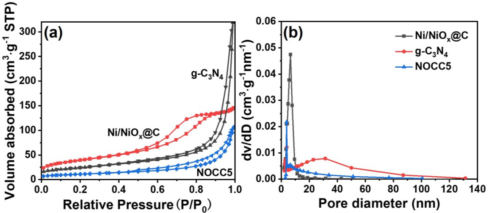
> - **高光强（$500\ \mathrm{mW\cdot cm^{-2}}$）干粉光热升温曲线（157.9 °C）**：Figure S21  
>   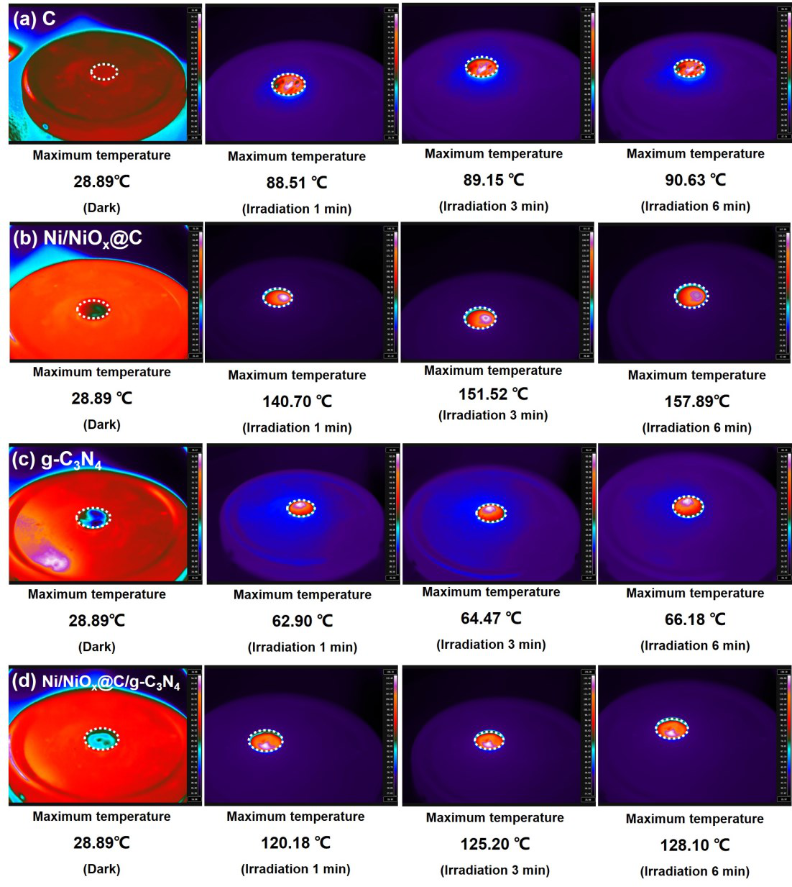
> - **DFT 氢吸附模型与过渡态模型**：Figure S29 & S31  
>   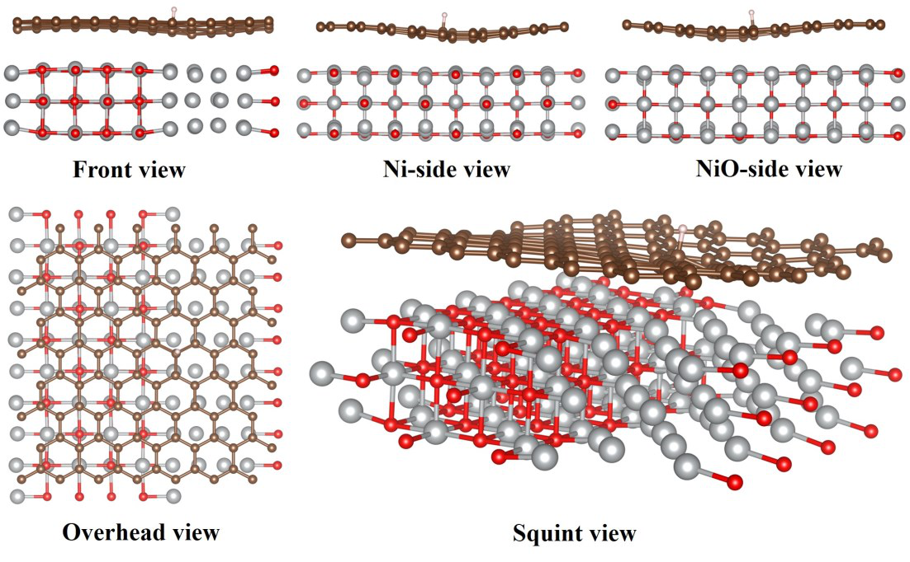  
>   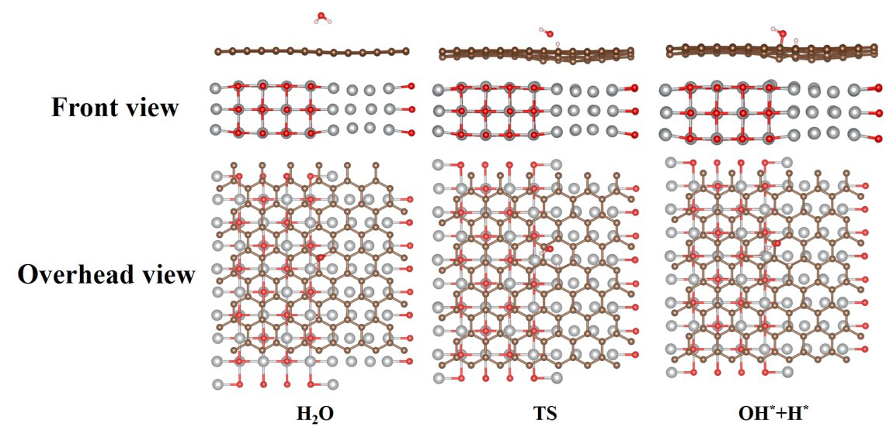  
>   *(注：全部 36 幅高清附图已完备抽离至 `images/SI/` 目录，并附有 `si_figures_manifest.json` 索引)*

---

## 8. 学术批判与复现缺口分析（Critical Appraisal）

依照 `wusen-paper-reader` 的学术求实准则，严格区分“作者报告”、“解读”与“假设”：

| 维度 | 文献报告现状 | 存在的科学缺口 / 未完全回答的问题 | 对复现与后续研究的启示 |
| :--- | :--- | :--- | :--- |
| **牺牲剂依赖** | 产氢活性是在 **10 vol% TEOA** 存在下测得的，TEOA 作为不可逆电子捕获剂。 | **尚未实现无牺牲剂的全解水（OWS）**。光催化氧化半反应产物及碳包覆层在长期光催化氧化环境下的耐受性未深入探讨。 | 无法直接等同于无牺牲剂的太阳能整体水裂解工业体系；在光催化反应器设计中须考虑牺牲剂的消耗成本与产物分离。 |
| **光热与光电贡献解耦** | 作者通过变温 PL 和无控温测试证明了光热升温的存在，并用阿伦尼乌斯公式拟合了表观活化能 $E_a$。 | **宏观温升（36.8 °C）与催化剂表面纳微区局部光热（Local Hot Spots）的真实温度无法严格原位分离**。升温在多大程度上影响半导体本征带隙、表面吸脱附平衡与电解质传质，尚缺乏原位稳态/瞬态吸收光谱定量解耦。 | 设计带精确外循环恒温（如维持 15 °C、25 °C、35 °C）的光催化对比实验，以严格量化“纯光催化”与“纯热效应”对产氢增强的净贡献率。 |
| **碳层包覆厚度的折中** | 柠檬酸煅烧原位形成的碳层为 2–3 层石墨碳。 | 碳层太薄无法保护 Ni 核免受酸碱腐蚀，太厚则会强烈遮挡入射光并增加载流子穿透势垒；文献未给出碳层层数可控调控的临界阈值。 | 复现实验时需严格控制柠檬酸/镍盐比例（1 g / 0.4 g）及升温程序，否则容易由于过度碳化或碳化不足导致 FLPs 密度骤降。 |
| **Jahn-Teller 效应诱导机制的微观直接观测** | 借助退火温度相关的相转变、EPR 信号及 EXAFS 配位数降低进行间接指认。 | 晶界处单原子级动态 Jahn–Teller 畸变缺乏原位超高分辨电镜或低温变温 EXAFS 的瞬态物理直接捕获，目前本质上仍属于“基于宏观谱学与晶体场理论的合理推论”。 | 可考虑结合原位同步辐射或原位球差电镜进一步捕捉相转变临界态的局部电子自旋态跳变。 |

---

## 9. 知识库 Benchmark 横向入库记录

本篇文献的关键性能指标已通过 `benchmark_collector.py` 结构化录入知识库性能总表：

```yaml
DOI: 10.1002/adma.202313513
Citation_Key: Yang-2024-AM
System: Ni/NiOx@C / g-C3N4 (NOCC5)
Reaction: Photothermal-assisted Photocatalytic H2 evolution
Rate: 10.71 mmol g-1 h-1 (10710 umol g-1 h-1)
AQY: 40.78% @ 380 nm
Light: 300W Xe (AM 1.5)
Scavenger: 10 vol% TEOA
Comparison: 1.76x of 1.0 wt% Pt/g-C3N4
Mechanism: Bipolar FLPs (FLP-VO-C & FLP-VNi-C) + Photothermal
Ledger_Path: 知识库/04-科研学术/benchmarks.csv
```
