# Unveiling the Synergistic Role of Frustrated Lewis Pairs in Carbon-Encapsulated Ni/NiOx Photothermal Cocatalyst for Enhanced Photocatalytic Hydrogen Production

Unveiling the Synergistic Role of Frustrated Lewis Pairs in Carbon-Encapsulated Ni/NiO $_{x}$ Photothermal Cocatalyst for Enhanced Photocatalytic Hydrogen Production

Zhi Yang, Taiyu Huang, Meng Li, $^{*}$ Xudong Wang, Xiaosong Zhou, Siyuan Yang, Qiongzhi Gao, Xin Cai, Yingju Liu, Yueping Fang, Yu Wang, Shanqing Zhang, $^{*}$ and Shengsen Zhang $^{*}$

The development of high-density and closely spaced frustrated Lewis pairs (FLPs) is crucial for enhancing catalyst activity and accelerating reaction rates. However, constructing efficient FLPs by breaking classical Lewis bonds poses a significant challenge. Here, this work has made a pivotal discovery regarding the Jahn–Teller effect during the formation of grain boundaries in carbon-encapsulated Ni/NiOx (Ni/NiO $_{x}$ @C). This effect facilitates the formation of high-density O (V $_{O}$ ) and Ni (V $_{Ni}$ ) vacancy sites with different charge polarities, specifically FLP-V $_{O}$ -C basic sites and FLP-V $_{Ni}$ -C acidic sites. The synergistic interaction between FLP-V $_{O}$ -C and FLP-V $_{Ni}$ -C sites not only reduces energy barriers for water adsorption and splitting, but also induces a strong photothermal effect. This mutually reinforcing effect contributes to the exceptional performance of Ni/NiO $_{x}$ @C as a cocatalyst in photothermal-assisted photocatalytic hydrogen production. Notably, the Ni/NiO $_{x}$ @C/g-C $_{3}$ N $_{4}$ (NOCC) composite photocatalyst exhibits remarkable hydrogen production activity with a rate of 10.7 mmol g $^{-1}$ h $^{-1}$ , surpassing that of the Pt cocatalyst by 1.76 times. Moreover, the NOCC achieves an impressive apparent quantum yield of 40.78% at a wavelength of 380 nm. This work paves the way for designing novel defect-state multiphase cocatalysts with high-density and adjacent FLP sites, which hold promise for enhancing various catalytic reactions.

## 1. Introduction

The increasing demand for clean energy conversion has driven the exploration of semiconductor photocatalytic water splitting for hydrogen production. $^{[1]}$ However, single-component semiconductor photocatalysts suffer from low activity due to ultrafast recombination of charge carriers and sluggish interfacial dynamics. To overcome these limitations, coupling cocatalysts have emerged as an effective strategy to enhance carrier mobility and interfacial reactions. $^{[2]}$ Noble metal nanoparticles such as Pt have demonstrated exceptional activity and stability as photocatalytic cocatalysts for hydrogen production. $^{[3]}$ Nevertheless, their exorbitant cost and limited accessibility impede their practical implementation in the field of photocatalysis. In recent years, multicomponent heterostructures, such as binary non-noble metal alloys, $^{[4]}$ metal-carbon, $^{[5]}$ and metal-semiconductor, $^{[6]}$ have garnered attention due to their innovative design and powerful synergistic effects, resulted in remarkable progress in enhancing the performance of photocatalytic hydrogen production. $^{[7]}$ However, there is still a severe lack of efficient methods to establish structure–activity relationships among the above multicomponent constituents and gain insight into the active sites of heterogeneous catalysts.

E-mail: limeng@gdut.edu.cn; s.zhang@griffith.edu.au, s.zhang@gdut.edu.cn

Z. Yang, T. Huang, S. Yang, Q. Gao, X. Cai, Y. Liu, Y. Fang, S. Zhang
Guangdong Laboratory for Lingnan Modern Agriculture
Key Laboratory for Biobased Materials and Energy of Ministry of Education
College of Materials and Energy
South China Agricultural University
Guangzhou, Guangdong 510643, P. R. China
E-mail: zhangss@scau.edu.cn

M. Li, S. Zhang

Institute for Sustainable Transformation

School of Chemical Engineering and Light Industry

Guangdong University of Technology

Guangzhou, Guangdong 510006, P. R. China

The ORCID identification number(s) for the author(s) of this article can be found under https://doi.org/10.1002/adma.202313513

Guangdong Laboratory of Chemistry and Fine Chemical Industry Jieyang Center

© 2024 The Authors. Advanced Materials published by Wiley-VCH GmbH. This is an open access article under the terms of the Creative Commons Attribution-NonCommercial License, which permits use, distribution and reproduction in any medium, provided the original work is properly cited and is not used for commercial purposes.

Jieyang, Guangdong 515200, China
X. Wang

SMOE Key Laboratory of Bioinorganic and Synthetic Chemistry
Lehn Institute of Functional Materials

School of Chemistry

DOI: 10.1002/adma.202313513

Sun Yat-sen University

Guangzhou, Guangdong 510275, China

© 2024 The Authors. Advanced Materials published by Wiley-VCH GmbH

In the field of heterogeneous catalysis, constructing frustrated Lewis pairs (FLPs) provides a concise and effective approach to modifying interfaces. $^{[8]}$ FLPs maintain the fundamental interaction between Lewis acids and bases through steric hindrance or electronic effects, enabling the activation of small molecules. $^{[9]}$ However, breaking classical Lewis acid-base bonds to construct FLPs is challenging. Fortunately, the presence of structural defects in solid “rigid” frameworks offers opportunities to design and synthesize semi-solid and solid FLP-like catalysts. $^{[10]}$ For example, vacancy cluster-mediated solid FLPs on the surface of $CeO_{2}$ have been used for efficient $CO_{2}$ conversion to dimethyl carbonate with 100% atomic utilization. $^{[11]}$ And spatially separated Lewis base and acid pairs mediated by oxygen vacancy surface defects on $\mathrm{In}_{2}\mathrm{O}_{3-x}(\mathrm{OH})_{y}$ can extend the charge carrier lifetime and enhance gas-phase photocatalytic reactions. $^{[12]}$ It can be inferred that defect states and interface regulation play crucial roles in energy conversion-related catalytic processes during the construction of heterogeneous FLP catalysts.

On the other hand, the Shockley–Read–Hall (SRH) recombination theory suggests that defect levels in semiconductors act as efficient nonradiative recombination centers, leading to effective photothermal effects when exposed to light. $^{[13]}$ The resultant temperature difference potential can overcome the limitations of external auxiliary voltage, facilitate carrier separation, suppress recombination, extend carrier lifetime, and enhance the performance of photocatalysts with deep-level defects. $^{[14]}$ However, the current literature on high-efficiency photothermal composite catalysts, which consist of both hydrogen evolution cocatalysts and host photocatalysts, is limited. $^{[15]}$ This limitation arises from the weak photothermal effect of the cocatalyst and its low content in the composite catalyst, $^{[16]}$ thereby necessitating the design and synthesis of cocatalysts with enhanced photothermal conversion efficiency and hydrogen evolution functionality.

Since its emergence in 2009, polymeric graphitic carbon nitride (g-C $_3$ N $_4$ ) has attracted significant interest due to its responsiveness to visible light, affordability, and conducive band structure for photocatalytic hydrogen evolution. $^{[1b]}$ However, the practical application of pristine g- $C_{3}N_{4}$ remains limited due to its substantial recombination rate of photogenerated carriers and relatively poor optical conversion efficiency. In this work, we employed the Jahn–Teller effect, which occurs during grain boundary formation, to fabricate a defect-rich carbon-encapsulated Ni/ $NiO_{x}$ (Ni/ $NiO_{x}@C$ ) cocatalyst with high-density FLP sites for enhancing the photocatalytic hydrogen production efficiency of g- $C_{3}N_{4}$ . Theoretical calculations and quantitative electron spin resonance (ESR) tests confirm the presence of O vacancies ( $V_{O}$ ) and Ni vacancies ( $V_{Ni}$ ) at the grain boundaries in Ni/ $NiO_{x}@C$ . These defect sites induce spatial charge polarization and enhanced $\pi-\pi$ conjugation with the graphite carbon layer nearby, forming effective FLPs known as FLP- $V_{O}-C$ basic sites and FLP- $V_{Ni}-C$ acidic sites. The synergistic effect of FLP- $V_{O}-C$ and FLP- $V_{Ni}-C$ sites significantly lowers the energy barriers for water adsorption and decomposition, as evidenced by computational results and Arrhenius equation fitting. Furthermore, infrared thermography, Kelvin probe force microscopy (KPFM), and variable-temperature fluorescence tests have revealed that nonradiative recombination induced by Ni/ $NiO_{x}@C$ defects results in a photothermal effect, leading to thermal activation and accelerated reaction kinetics. Supported by the FLPs, the photocatalytic activity of g- $C_{3}N_{4}$ loaded with 5 wt% Ni/ $NiO_{x}@C$ exhibits an increase in photocatalytic activity of over 268 times and demonstrates long-term durability. Therefore, the design of photocatalytic cocatalysts with FLPs holds significant potential for energy conversion applications.

## 2. Results and Discussion

## 2.1. Synthesis and Structural Characterization

The preparation process of the Ni/NiO $_{x}$ @C cocatalyst is illustrated in Figure 1a. Initially, a three-dimensional network precursor gel was synthesized by blending nickel acetate and citric acid in an ethanol–water solution at 80 °C. Subsequently, the Ni/NiO $_{x}$ @C cocatalyst was obtained via calcination under an argon atmosphere. The catalysts obtained at different temperature conditions, namely 300 °C, 350 °C, 400 °C, and 450 °C, were designated as OC300, NOC350, NOC400, and NC450, respectively. Lastly, the fabrication process of the Ni/NiO $_{x}$ @C/g-C $_{3}$ N $_{4}$ composite photocatalysts involved the coupling of Ni/NiO $_{x}$ @C with g-C $_{3}$ N $_{4}$ photocatalysts via ultrasonication and mechanical grinding. Four distinct weight ratios of Ni/NiO $_{x}$ @C to g-C $_{3}$ N $_{4}$ were employed: 1.0 wt% (NOCC1), 3.0 wt% (NOCC3), 5.0 wt% (NOCC5), and 7.0 wt% (NOCC7). The compositions derived from OC300, NOC350, NOC400, and NC450 were named OCC300, NOCC350, NOCC400 is the same as NOCC5, and NCC450, respectively, in a corresponding manner.

The X-ray diffraction (XRD) pattern depicted in Figure 1b reveals the impact of calcination temperature on the phase composition of the Ni/NiO $_{x}$ @C cocatalyst. At 300 °C, distinct diffraction peaks are observed corresponding to the C (200) plane and a NiO lattice structure (JCPDS No.47–1049), indicating the formation of NiO $_{x}$ @C through the decomposition of citric acid (carbon source). As the temperature gradually increases to 400 °C, closely overlapping doublet peaks emerge for both NiO (200) and Ni (111) lattice diffractions (JCPDS code: 04–0850). The crystal lattice diffraction of both Ni and NiO belongs to the cubic crystal space group Fm-3m (225), suggesting a significant phase transition within this temperature range. At 450 °C, a prominent diffraction signal at 44.5°, attributed to metallic Ni indicates a crystalline phase transformation from NiO@C to Ni@C during the annealing process. The relationship between phase transition and temperature is further confirmed through thermogravimetric analysis of the precursor gel (Figure S1, Supporting Information). Moreover, it is noteworthy that the diffraction of both the high-temperature samples (C and NiO crystals) significantly decreases, indicating the crucial role played by the graphitic carbon layer in maintaining the stability of the three-phase interface.

ADVANCED
SCIENCE NEWS \_\_\_\_
www.advancedsciencenews.com

X. Zhou 
School of Chemistry and Chemical Engineering 
Key Laboratory of Clean Energy Materials Chemistry of Guangdong 
Higher Education Institutes 
Lingnan Normal University 
Zhanjiang, Guangdong 524048, P. R. China 
Y. Wang 
Shanghai Synchrotron Radiation Facility 
Zhangjiang Laboratory 
Shanghai Advanced Research Institute 
Chinese Academy of Sciences 
Shanghai 201204, China 
S. Zhang 
Centre for Clean Environment and Energy and School of Environment and Science 
Gold Coast Campus 
Griffith University 
Queensland 4222, Australia

© 2024 The Authors. Advanced Materials published by Wiley-VCH GmbH

15214095, 21024, 24, Downloaded from https://advanced.onlinelibrary.wiley.com/doi/10.1002/adma.202313513 by Sen Wu., Wiley Online Library on [17/10/2026]. See the Terms and Conditions (https://onlinelibrary.wiley.com/terms-and-conditions) on Wiley Online Library for rules of use; OA articles are governed by the applicable Creative Commons License

![Figure 1. a) Schematic diagram of the preparation process of Ni/NiO ₓ @C cocatalyst and Ni/NiO ₓ @C/g-C ₃ N ₄ photocatalyst. b) X-ray diffraction (XRD) patterns of Ni/NiO ₓ @C structures under different temperatures. c,d) Transmission electron microscope (TEM) images of Ni/NiO ₓ @C samples. e) Aberration-corrected high-angle annular dark-field scanning transmission electron microscopy (AC-HAADF-STEM) of Ni/NiO ₓ @C. f) XRD patterns of Ni/NiO ₓ @C/g-C ₃ N ₄ with different loading amounts. g-h) TEM images and i) TEM/energy-dispersive spectroscopy (TEM-EDS) mapping of NOCC5.](images/3XGQUZAW-3J5NQIKD/efb4451ba0b5f2458d95bb3ef16dde1c94cd485ce2ee97c5a7e4d09fa0b45615.png) ^fig1

Figure 1. a) Schematic diagram of the preparation process of Ni/NiO $_{x}$ @C cocatalyst and Ni/NiO $_{x}$ @C/g-C $_{3}$ N $_{4}$ photocatalyst. b) X-ray diffraction (XRD) patterns of Ni/NiO $_{x}$ @C structures under different temperatures. c,d) Transmission electron microscope (TEM) images of Ni/NiO $_{x}$ @C samples. e) Aberration-corrected high-angle annular dark-field scanning transmission electron microscopy (AC-HAADF-STEM) of Ni/NiO $_{x}$ @C. f) XRD patterns of Ni/NiO $_{x}$ @C/g-C $_{3}$ N $_{4}$ with different loading amounts. g-h) TEM images and i) TEM/energy-dispersive spectroscopy (TEM-EDS) mapping of NOCC5.

Transmission electron microscope (TEM) images of the Ni/NiO $_{x}$ @C at the nanoscale (Figure 1c and Figure S2, Supporting Information) unveil the presence of a tightly embedded 5 nm Ni/NiO $_{x}$ within the graphitized carbon cage, establishing covalent connections among the carbon layers and giving rise to a pomegranate-like superstructure. Additionally, the field emission scanning electron microscope images in Figure S3 (Supporting Information) showcase the single particle-crosslinked Ni/NiO $_{x}$ @C through the carbonization of the gel precursor. Upon closer inspection with the high-resolution TEM (HRTEM)

images in Figure 1c,d, scattered regions of point defects (white dashed circular area) in Ni/NiO $_{x}$ @C are revealed, suggesting that the lattice defects are a consequence of the Jahn–Teller effect induced by the elevated temperature and oxygen-deficient atmosphere. $^{[17]}$ The graphitized carbon coating layer reveals the presence of two distinct lattice spacings, measuring 0.203 and 0.209 nm respectively, which correspond to the crystal planes of Ni (111) and NiO (200). Additionally, subtle lattice distortions are clearly observed in certain parts of the HRTEM image in Ni/NiO $_{x}$ (highlighted in yellow). Through aberration-corrected high-angle annular dark-field scanning transmission electron microscopy (AC–HAADF–STEM) observation of the atomic lattice distribution in Ni/NiO $_{x}$ @C, as shown in Figure 1e and Figure S4 (Supporting Information), we observe dim atomic vacancies (highlighted in deep blue) and defect structures at the lattice edges (marked in light blue) in the lattice space. Furthermore, slight distortions in the lattice can be observed (marked in white), indicating that the Jahn–Teller effect causes lattice distortions during the formation of mixed crystal phases. Covalent bonding with graphitized carbon is suggested to promote the formation of abundant multicomponent interface contact points. Moreover, the TEM/energy-dispersive spectroscopy (TEM-EDS) elemental mapping of Ni/NiO $_{x}$ @C in Figure S5 (Supporting Information) provides evidence of the homogeneous distribution of Ni and O elements within the central region of the sample, while the outer edge area exhibits a uniform distribution of C element. These observations suggest that the comprehensive architecture of Ni/NiO $_{x}$ @C is formed by the graphitized carbon coating structure, in conjunction with its co-formation with the Ni/NiO $_{x}$ /C ternary interface.

15214095, 2024, 24, Downloaded from https://advanced.onlinelibrary.wiley.com/doi/10.1002/adma.202313513 by Sen Wu, Wiley Online Library on [17/10/2026]. See the Terms and Conditions (https://onlinelibrary.wiley.com/terms-and-conditions) on Wiley Online Library for rules of use; OA articles are governed by the applicable Creative Commons License

ADVANCED
SCIENCE NEWS \_\_\_\_
www.advancedsciencenews.com

© 2024 The Authors. Advanced Materials published by Wiley-VCH GmbH

The XRD patterns of Ni/NiO $_x$ @C/g-C $_3$ N $_4$ (Figure 1f) display an enhancement in the intensity of the characteristic peak for Ni/NiO $_x$ @C with increasing loading amount. However, at 1.0 wt% Pt/g-C $_3$ N $_4$ , the Pt loading is insufficient, leading to the overshadowing of its characteristic peak by g-C $_3$ N $_4$ . The HRTEM image and TEM-EDS elemental mapping in Figure S6 (Supporting Information) demonstrate a homogeneous distribution of Pt nanoparticles on g-C $_3$ N $_4$ . Figure 1g presents the HRTEM image of NOCC5, where closely integrated and uniformly dispersed 5.0 wt% Ni/NiO $_x$ @C nanoparticles within the g-C $_3$ N $_4$ . The intimate contact between Ni/NiO $_x$ @C and g-C $_3$ N $_4$ , as shown in Figure 1h, facilitates interfacial electron exchange and rearrangement. The Fourier transform infrared spectra (Figure S7, Supporting Information) reveal analogous absorption peaks for NOCC5 and g-C $_3$ N $_4$ , indicating that their interactions are primarily governed by noncovalent forces. The elemental distribution, as shown in Figure 1i and Figure S8 (Supporting Information), displays a concurrent presence of C, N, and O in a comparable area, with Ni elements presenting a uniform point-like distribution interspersed among C and N elements. The use of AC-HAADF-STEM and DES allows for higher magnification and more precise observations (Figure S9, Supporting Information). This observation further substantiates the homogeneous integration of Ni/NiO $_x$ @C and g-C $_3$ N $_4$ at the nanoscale, indicating a well-distributed and efficient synergy between these materials.

Analysis of the nitrogen adsorption-desorption isotherm curve for the samples (Figure S10 and Table S1, Supporting Information) reveals a remarkable decrease in specific surface area, pore volume, and pore size for NOCC5 compared to $\mathrm{g - C_3N_4}$ . This reduction can be ascribed to the mutual embedding of $\mathrm{Ni / NiO_x@C}$ within $\mathrm{g - C_3N_4}$ at the microscopic level, indicating that ultrasonically assisted coprecipitation and mechanical grinding are effective in achieving a cohesive coupling of these materials.

The Raman spectra were utilized to characterize the defect states and the carbon layer structure in the catalysts. The presence of $V_{Ni}$ is signified by distinctive peak signals associated with NiO (see the detailed analysis procedure for Figure S11, Supporting Information). An $I_{G}/I_{D}$ ratio exceeding 1 suggests the predominance of graphitized carbon in the catalysts. $^{[18]}$ The broad peaks ranging from 2500 to 3000 cm $^{-1}$ can be attributed to the two-dimensional diffraction peaks of multilayer graphitized carbon.

The X-ray photoelectron spectroscopy (XPS) survey spectra (Figure S12, Supporting Information) have confirmed the presence of C, O, N, and Ni elements in the samples. The high-resolution XPS spectra provide intricate insights into the surface chemical composition and electronic states of the samples. Figure 2a demonstrates that the C 1s spectra of the synthesized cocatalysts at different temperatures exhibit three distinct sub-peaks at 284.8, 286.4, and 288.8 eV, corresponding to C–C, C–O, and C = O bonds, respectively. $^{[19]}$ With the enhanced degree of graphitization, a noticeable decrease in the intensity of both C–O and C = O bonds is observed. The C 1s spectra of NOCC5 exhibit four subpeaks at 284.8, 286.3, 288.6, and 294.1 eV, which align with C–C, C–O, N–C = N and C–N bonds, respectively. $^{[20]}$ The latter two peaks can be attributed to the substantial presence of g-C $_{3}$ N $_{4}$ in the sample. Figure S13 (Supporting Information) primarily showcases the chemical structure of g-C $_{3}$ N $_{4}$ in the N 1s spectra of NOCC, with the C = N–C, N–C3, and N–C bonds appearing at 398.8, 400.2, and 401.4 eV, respectively. The subtle peak at 404.6 eV is indicative of the π-bond excitation in g-C $_{3}$ N $_{4}$ . Figure 2b reveals that the O 1s spectra exhibit four peaks, corresponding to Ni–O, O–C = O, and V $_{O}$ vacancies; ${}^{[21]}$ Notably, the intensity of Ni–O peak fluctuates with variations in the NiO content. A shift in the binding energy of Vo to a lower energy level is observed as the Vo content increases. $^{[7b]}$ The O 1s spectra of NOCC5 feature two subpeaks at 529.5 and 532.4 eV, representing Ni–O and O–C = O bonds respectively. However, due to the low loading amount of NOC400 (5.0 wt%), the peak associated with Vo is overshadowed by the more pronounced O–C = O bond peak. The Ni 2p spectra in Figure 2c have four distinctive peaks labeled as Ni $^{0}$ , Ni $^{2+}$ , Ni $^{3+}$ , and the Ni satellite peak. These characteristic peaks are derived from a dual-peak fitting analysis of the diffraction peaks for both Ni 2p $_{1/2}$ and Ni 2p $_{3/2}$ . $^{[22]}$ The Ni $^{0}$ peak originates from elemental nickel, while the Ni $^{2+}$ peak is attributed to NiO, with the intensities of these peaks being dependent on the relative content of Ni and NiO. $^{[7b]}$ Conversely, the low-spin Ni $^{3+}$ peak is affected by the presence of V $_{Ni}$ vacancies. NOCC exhibits a similar Ni 2p spectrum akin to that of NOC400. However, due to the electron enrichment from g-C $_{3}$ N $_{4}$ to NOC400, there is an overall transfer of cocatalyst to lower binding energies.

The relative content of $V_{Ni}$ and Vo in the $Ni/NiO_{x}@C$ catalyst was quantified via ESR testing (Figure 2d,e and Table S2, Supporting Information), where the concentrations of $V_{O}$ in OC300, NOC350, NOC400, and NC450 are $1.950e^{+14}$ , $1.422e^{+14}$ , $1.595e^{+14}$ , and $1.735e^{+14}$ spins mm $^{-3}$ , respectively; while the corresponding $V_{Ni}$ concentrations are $4.916e^{+12}$ , $6.126e^{+12}$ , $5.870e^{+12}$ , and $5.156e^{+12}$ spins mm $^{-3}$ , respectively. The ratios of $V_{Ni}/V_{O}$ are calculated to be 0.025, 0.043, 0.037, and 0.029, respectively. These results indicate that $Ni/NiO_{x}@C$ exhibits a higher concentration of $V_{Ni}$ but a lower concentration of $V_{O}$ compared to NiO@C and Ni@C. This implies that the reconstruction of grain boundaries favors the modulation of defect composition at the grain boundaries.

The precise coordination environment and electronic structure of the samples were investigated through X-ray absorption spectroscopy (XAS) at different temperatures. Figure 2f reveals the energy absorption curve, which indicates that the pre-edge peak absorption threshold of the catalyst strengthens gradually with increasing temperature, suggesting a reversible transformation of the crystal structure from an octahedral to a tetrahedral. $^{[23]}$ The near-edge absorption threshold of K-edge X-ray absorption near-edge structure (XANES) tends to shift toward the lower energy region, indicating a decrease in the oxidation state of Ni in the material. NOC450 exhibits a near-edge absorption threshold similar to that of Ni foil, while OC300, behaving as a higher-defect $Ni^{3+}$ , demonstrates a higher near-edge absorption threshold compared to NiO foil. The near-edge absorption thresholds of NOC350 and NOC400 lie between these two extremes, consistent with the observed phase transition trend in X-ray diffraction (XRD) measurements. $^{[24]}$ Additionally, the intensity of the white line peak gradually diminishes as the conversion from NiO phase to Ni phase takes place, indicating that the metal oxides formed at low temperatures during the annealing process possess strong electron transition capabilities. $^{[25]}$ Therefore, it can be speculated that the polycrystalline phase transition is likely to induce level splitting and lattice distortion due to the Jahn–Teller effect.

ADVANCED
SCIENCE NEWS \_\_\_\_
www.advancedsciencenews.com

© 2024 The Authors. Advanced Materials published by Wiley-VCH GmbH

15214095, 2024, 24, Downloaded from https://advanced.onlinelibrary.wiley.com/doi/10.1002/adma.202313513 by Sen Wu, Wiley Online Library on [17/10/2026]. See the Terms and Conditions (https://onlinelibrary.wiley.com/terms-and-conditions) on Wiley Online Library for rules of use; OA articles are governed by the applicable Creative Commons License

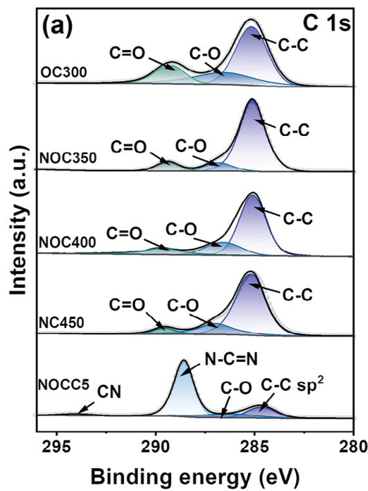

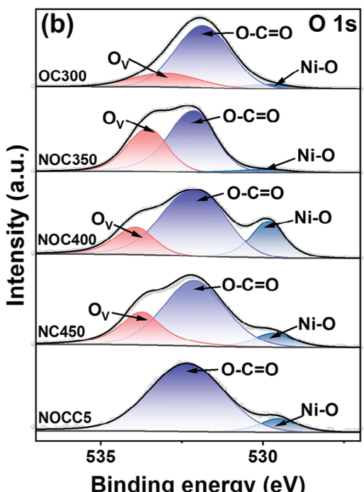

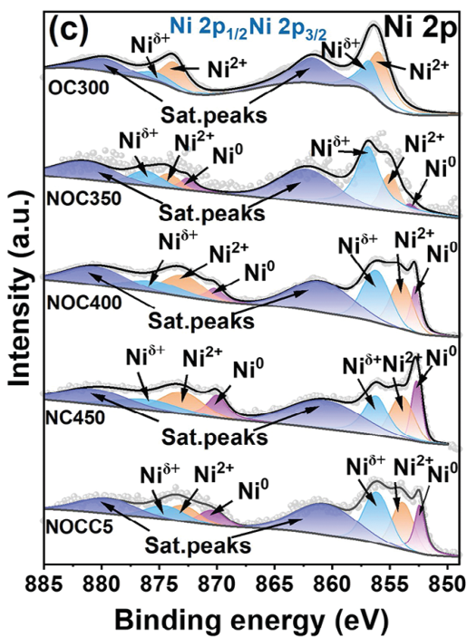

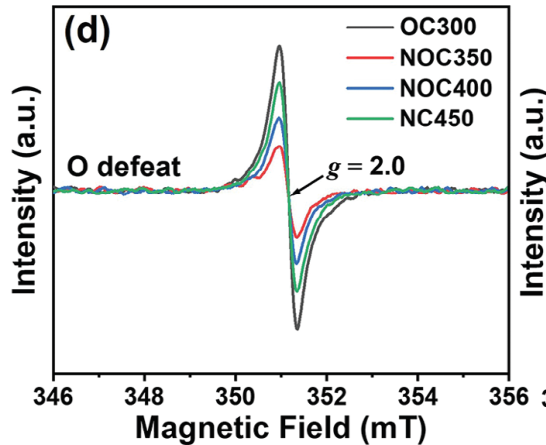

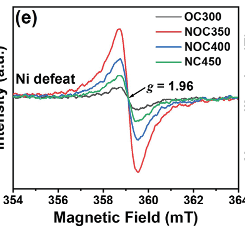

 ^fig2

Figure 2. X-ray photoelectron spectroscopy (XPS) (a–c) and electron spin resonance (ESR) (d,e) spectra of OC300, NOC350, NOC400, NOC450, and NOCC5. a) C 1s spectrum; b) O 1s spectrum; c) Ni 2p spectrum; d) O vacancies; e) Ni vacancies; f) X-ray absorption spectroscopy (XAS) of Ni foil, NiO foil, OC300, NOC350, NOC400, and NOC450.

Through an analysis of the extended X-ray absorption fine structure (EXAFS) and wavelet transform of the Ni K-edge (Figure S14–S17, Supporting Information), it is observed that the catalyst exhibits a temperature-dependent increase in the intensity of resonance peaks in the Ni K-space EXAFS, indicating a higher degree of unsaturation in the crystals prepared at lower temperatures. The polarized peak shifts toward the right, indicating a phase transition from NiO to Ni. $^{[26]}$ In the R-space EXAFS of Ni, the primary coordination modes observed in $Ni/NiO_{x}@C$ include Ni–O, Ni–Ni, and Ni–Ni (NiO), with lower coordination numbers compared to those in Ni and NiO foils. This indicates a high degree of disorder in the polycrystalline structure that is prone to forming structural defects. The coordination bond lengths are approximately 1.6, 2.2, and 2.6, respectively. Figure S16 (Supporting Information) confirms the presence of vacancies around O and Ni sites near Ni–O and Ni–Ni sites by showing smaller coordination bond lengths compared to standard samples of pure Ni and NiO. $^{[27]}$

## 2.2. Optical Properties and Photothermal Effects

The optical properties of the catalysts were examined through ultraviolet–visible (UV–Vis) diffuse reflectance spectra. Compared to Ni@C and $NiO_{x}@C$ counterparts, the $Ni/NiO_{x}@C$ samples demonstrate superior light absorption capabilities (Figure S18, Supporting Information). For $Ni/NiO_{x}@C/g-C_{3}N_{4}$ photocatalysts, a heightened light absorption within the 200–800 nm range is observed with increasing loading amounts of $Ni/NiO_{x}@C$ (Figure 3a), surpassing the absorption of both g- $C_{3}N_{4}$ and 1 wt% Pt/g- $C_{3}N_{4}$ . This result underscores the efficient photon capture capability of the $Ni/NiO_{x}@C$ cocatalysts.

15214095, 2024, 24, Downloaded from https://advanced.onlinelibrary.wiley.com/doi/10.1002/adma.202313513 by Sen Wu, Wiley Online Library on [17/10/2026]. See the Terms and Conditions (https://onlinelibrary.wiley.com/terms-and-conditions) on Wiley Online Library for rules of use; OA articles are governed by the applicable Creative Commons License

ADVANCED
SCIENCE NEWS \_\_\_\_
www.advancedsciencenews.com

© 2024 The Authors. Advanced Materials published by Wiley-VCH GmbH

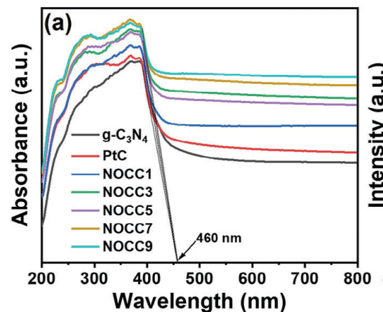

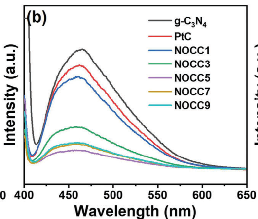

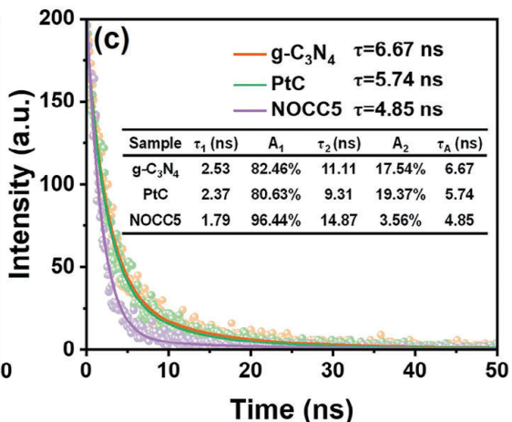

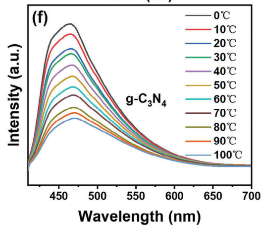

 ^fig3

Figure 3. Optical properties and photothermal effect of g- $C_{3}N_{4}$ , 1.0 wt% Pt/g- $C_{3}N_{4}$ , and NOCC samples: a) UV–Vis absorption spectra; b) fluorescence spectra; c) fluorescence lifetime spectra; infrared thermal imaging of d) g- $C_{3}N_{4}$ and e) NOCC5; temperature-dependent fluorescence spectra of f) g- $C_{3}N_{4}$ and g) NOCC5.

The absorption edges of the photocatalysts are all at 460 nm, indicating that the co-catalyst does not alter the bandgap width of the photocatalyst. Calculating from the bandgap formula $E_{g} = 1240/\lambda$ , the bandgap width of the photocatalyst is approximately 2.7 eV. Furthermore, the fluorescence spectra of $Ni/NiO_{x}@C$ display dual fluorescence excitation, characterized by emissions at 320 nm (strong excitation) and 420 nm (weak excitation), as illustrated in Figure S19 (Supporting Information). The strong excitation can be attributed to the intrinsic excited state of the material, while the weak excitation is speculated to arise from defect energy levels generated by defect states. This suggests that $Ni/NiO_{x}@C$ material operates via a composite mechanism involving both radiative and nonradiative processes. The integration of $Ni/NiO_{x}@C$ cocatalysts in photocatalysts, as shown in

Figure 3b, leads to a significant reduction in photogenerated charge recombination, achieving the lowest intensity at a cocatalyst loading of 5.0 wt%. Additionally, the decay spectra obtained through time-resolved photoluminescence (TRPL) were utilized to investigate the dynamics of photoinduced charge carriers. As depicted in Figure 3c, two distinct decay mechanisms are observed: where $\tau_{1}$ and $\tau_{2}$ represent the nonirradiative recombination and interband recombination, respectively. $A_{1}$ and $A_{2}$ denote their corresponding amplitudes. The average emission lifetime ( $\tau_{A}$ ) can be estimated by fitting the following double-exponential function: $^{[28]}$

$$
\pmb {\tau} _ {A} = \frac {A _ {1} \pmb {\tau} _ {1} ^ {2} + A _ {2} \pmb {\tau} _ {2} ^ {2}}{A _ {1} \pmb {\tau} _ {1} + A _ {2} \pmb {\tau} _ {2}}\tag{1}
$$

15214095, 2024, 24, Downloaded from https://advanced.onlinelibrary.wiley.com/doi/10.1002/adma.202313513 by Sen Wu, Wiley Online Library on [17/10/2026]. See the Terms and Conditions (https://onlinelibrary.wiley.com/terms-and-conditions) on Wiley Online Library for rules of use; OA articles are governed by the applicable Creative Commons License

ADVANCED
SCIENCE NEWS \_\_\_\_
www.advancedsciencenews.com

© 2024 The Authors. Advanced Materials published by Wiley-VCH GmbH

The short fluorescence lifetime ( $\tau_{1}=1.79$ ns) of NOCC5 is significantly lower compared to g- $C_{3}N_{4}$ ( $\tau_{1}=2.53$ ns) and PtC ( $\tau_{1}=2.37$ ns), and the amplitude $A_{1}$ is also reduced. In contrast, the long fluorescence lifetime ( $\tau_{2}$ ) increases while the amplitude $A_{2}$ undergoes a significant decrease. The calculated average fluorescence lifetime ( $\tau_{A}$ ) for NOCC5 ( $\tau_{A}=4.85$ ns) is lower than that of g- $C_{3}N_{4}$ ( $\tau_{A}=5.74$ ns) and PtC ( $\tau_{A}=6.67$ ns). Therefore, it can be inferred that upon photoexcitation, electrons from the valence band top transition in g- $C_{3}N_{4}$ are captured by the defect levels of Ni/NiO $_{x}$ @C, with the released energy being converted into phonons. Consequently, NOCC5 exhibits a more efficient nonradiative decay pathway, suggesting that the interface charge transfer between g- $C_{3}N_{4}$ and Ni/NiO $_{x}$ @C effectively suppresses the recombination of photoinduced charge carriers. Further elucidation of its charge transfer ability was achieved through photoelectrochemical tests. As shown in Figure S20 (Supporting Information), NOCC5 exhibits a lower charge transfer resistance and higher transient photocurrent compared to g- $C_{3}N_{4}$ . These results indicate a higher efficiency of interface charge transfer at the contact interface between Ni/NiO $_{x}$ @C and g- $C_{3}N_{4}$ .

The thermally induced properties of Ni/NiO $_{x}$ @C cocatalysts were analyzed using infrared thermal imaging to explore their radiative/nonradiative composite mechanism. As depicted in Figure 3d,e, the temperature of Ni/NiO $_{x}$ @C/g-C $_{3}$ N $_{4}$ system escalated from room temperature to 36.76 °C following 40 min of simulated sunlight irradiation, exhibiting a significant enhancement of 5.55 °C relative to pure g-C $_{3}$ N $_{4}$ . This observation suggests that the inclusion of the cocatalyst leads to a favorable photothermal effect, facilitating localized thermal activation. At an irradiation intensity of 500 mW cm $^{-2}$ , the temperatures of active C, Ni/NiO $_{x}$ @C, g-C $_{3}$ N $_{4}$ , and Ni/NiO $_{x}$ @C/g-C $_{3}$ N $_{4}$ samples rose from room temperature to 90.6 °C, 157.9 °C, 66.2 °C, and 128.1 °C, respectively, after a 6 min photothermal conversion duration (Figure S21, Supporting Information). These results highlight the exceptional photothermal conversion efficiency of Ni/NiO $_{x}$ @C.

To further elucidate the thermal effect mechanism on semiconductors, variable-temperature fluorescence spectra were utilized to analyze the NOCC5 sample. As shown in Figure 3f, an increase in temperature leads to a diminished photogenerated carrier recombination efficiency in $\mathrm{g - C_3N_4}$ , indicating that the thermal field effect effectively promotes the separation of photogenerated carriers. Figure 3g demonstrates that the fluorescence intensity of $\mathrm{Ni / NiO_x@C / g - C_3N_4}$ is comparatively lower than that of $\mathrm{g - C_3N_4}$ and significantly reduces as temperature increases, thereby confirming the remarkable photothermal catalytic effect of $\mathrm{Ni / NiO_x@C}$ .

## 2.3. Photothermal Properties and Photocatalytic $H_{2}$ Evolution Performance

Surface photovoltage measurements of NOCC5 were conducted via KPFM under both illuminated and dark conditions, to assess the impact of band gap transitions and photothermal effects on its photocatalytic hydrogen evolution activity. $^{[29]}$ As shown in Figures 4a and S22 (Supporting Information), the morphology and structure of the NOCC5 photocatalyst were unveiled through atomic force microscopy (AFM) imaging and 3D visualization.

The surface potential mappings (Figure 4b,c) indicate that g- $C_{3}N_{4}$ has a higher surface voltage compared to Ni/ $NiO_{x}@C/g-C_{3}N_{4}$ , implying electron transfer from g- $C_{3}N_{4}$ to the Ni/ $NiO_{x}@C$ cocatalyst. The line sweep image, derived from potential change mapping in Figure 4d, also shows a notable potential decrease from the g- $C_{3}N_{4}$ region to the Ni/ $NiO_{x}@C/g-C_{3}N_{4}$ region. Observing the potential changes in Figure 4e and Figure S23 (Supporting Information), it can be deduced that the overall surface voltage of the sample experiences a reduction of approximately 10–20 mV postillumination. This suggests that the photothermal effect induced by the Ni/ $NiO_{x}@C$ cocatalyst contributes positively toward facilitating localized thermal activation.

The rates of photocatalytic hydrogen evolution of various samples were compared under simulated sunlight irradiation to evaluate their activity and stability. The optimization experiment diagrams (Figure S24, Supporting Information) disclose that the ideal conditions for synthesizing Ni/NiO $_{x}$ @C include annealing for 8 h, using a nickel source content of 40%, and a loading ratio of 5 wt%. Throughout the experiments, it became evident that the annealing temperature critically influenced the efficacy of photocatalytic hydrogen production. As shown in Figure 4f, the composite photocatalysts OCC300, NOC350, NOC400, NCC450 and Pt/g-C $_{3}$ N $_{4}$ exhibited hydrogen production rates of 0.17, 8.97, 10.72, 6.23, and 6.09 mmol g $^{-1}$ h $^{-1}$ , respectively. Notably, NOCC5 achieved an extraordinary hydrogen evolution rate that was 268 times higher than that of pure g-C $_{3}$ N $_{4}$ and surpassed the optimal Pt/g-C $_{3}$ N $_{4}$ by a factor of 1.76 as well as outperforming previously reported catalysts (Table S3, Supporting Information). For a clearer visual representation of the catalyst's activity, Figure S25 (Supporting Information) shows a 10 mg sample centrifugally cast onto an FTO substrate. Under identical conditions, a continuous evolution of bubbles can be observed. The cyclic stability test outcomes (Figure 4g) demonstrate that NOCC5 retains about 92% of its catalytic activity after five continuous reaction cycles spanning 20 h. SEM images before and after four cycles of NOCC5 indicate minimal morphological changes in NOCC5 (Figure S26, Supporting Information). The XPS analysis before and after the reaction, as shown in Figure S27 (Supporting Information), reveals that only a small fraction of Ni in NOCC5 undergoes oxidation. This excellent stability is credited to the formation of a protective shell composed of graphitized carbon on the outer layer of cocatalyst, which effectively safeguards against internal Ni/NiO $_{x}$ corrosion-induced catalyst deactivation and facilitates the formation of FLP sites.

To further elucidate the thermal effect contribution to the process, the photocatalytic hydrogen production kinetic of different samples was investigated. The hydrogen production rates of various samples were examined at temperatures ranging from 15 °C to 45 °C (Figure S28, Supporting Information), with the correlation between these two variables shown in Figure S28f (Supporting Information). A linear relationship, based on the Arrhenius equation, was then established between the natural logarithm of the hydrogen production rate (Ln r μmol $^{-1}$ h $^{-1}$ ) and the inverse of temperature (1000 T $^{-1}$ in K $^{-1}$ ). As shown in Figure 4h, the apparent activation energy ( $E_{a}$ ) can be obtained from the slope of this linear relationship. $^{[29]}$ Compared to g-C $_{3}$ N $_{4}$ with an activation energy ( $E_{a}$ ) of 38.32 kJ mol $^{-1}$ , NOCC5 displays a considerably lower $E_{a}$ of 21.92 kJ mol $^{-1}$ . This suggests that the defect state-induced photothermal effect substantially augments

15214095, 2024, 24, Downloaded from https://advanced.onlinelibrary.wiley.com/doi/10.1002/adma.202313513 by Sen Wu, Wiley Online Library on [17/10/2026]. See the Terms and Conditions (https://onlinelibrary.wiley.com/terms-and-conditions) on Wiley Online Library for rules of use; OA articles are governed by the applicable Creative Commons License

ADVANCED
SCIENCE NEWS \_\_\_\_
www.advancedsciencenews.com

© 2024 The Authors. Advanced Materials published by Wiley-VCH GmbH

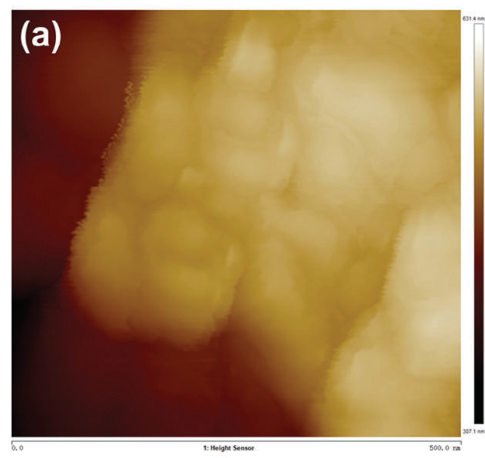

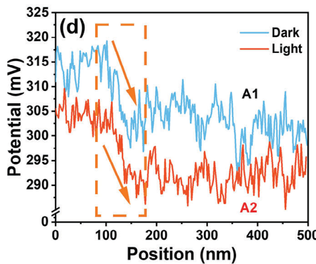

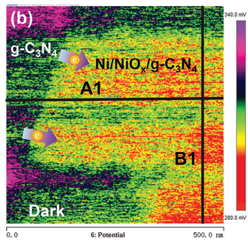

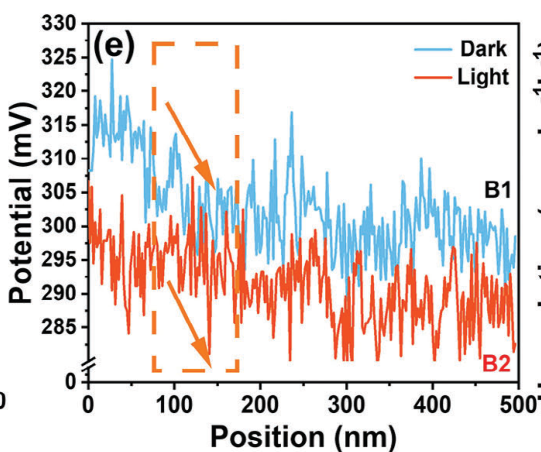

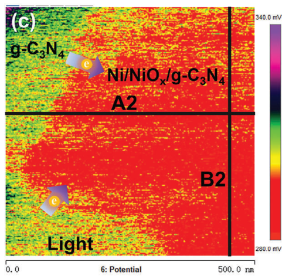

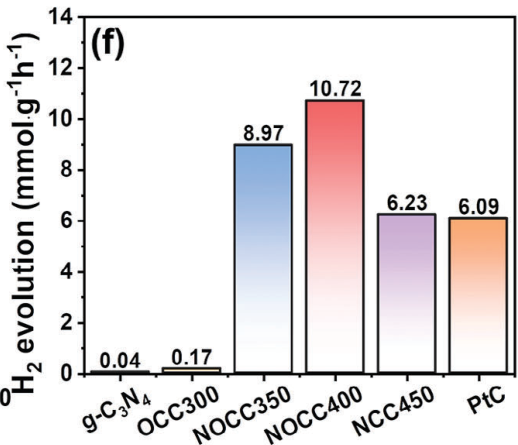

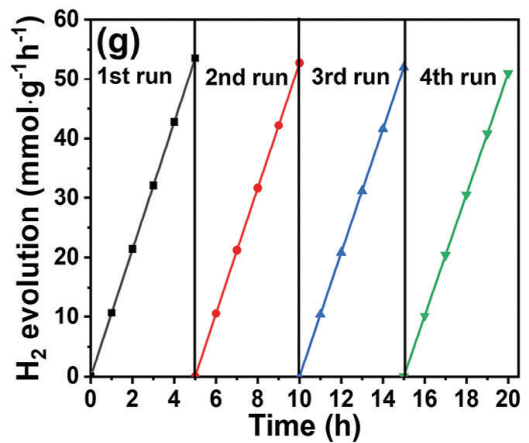

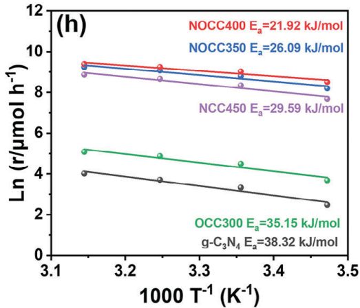

 ^fig4

Figure 4. a) Atomic force microscopy (AFM) image and b,c) surface potential mapping of NOCC5 sample; d,e) Line sweep images generated from potential change mapping in (b) and (c). f) Photocatalytic hydrogen evolution rates of different samples under simulated sunlight irradiation. g) Cycle performance diagram of the NOCC5 photocatalytic hydrogen evolution. h) Apparent activation energies of different samples; (i) AQYs of NOCC5 and $\mathrm{g - C_3N_4}$ .

## 2.4. Theoretical Calculations

the rate-limiting step of hydrogen evolution, aligning with the Tafel test results. Furthermore, Figure 4i and Table S4 (Supporting Information) demonstrate that the apparent quantum yield (AQY) of NOCC5 varies under different monochromatic light conditions in a manner that correlates with its UV–Vis absorption spectrum, confirming that its photocatalytic hydrogen evolution reaction is a light-driven process. $^{[30]}$ It is noteworthy that the AQY achieves the maximum value of 40.8% at 380 nm, consistent with the fluorescence excitation in the strong ultraviolet region shown in Figure S19 (Supporting Information). This finding implies that Ni/NiO $_{x}$ @C has an exceptional photon capture ability in the near-ultraviolet region, owing to its photothermal effect, underscoring the vital role of defect state-induced photothermal effects in boosting photocatalytic activity.

In light of the above-mentioned structural analysis and the outstanding catalytic activity of the Ni/NiO $_{x}$ @C cocatalyst, density-functional theory calculations were performed to more comprehensively assess the influence of FLPs on the reaction barriers pertinent to the dissociation of H $_{2}$ O molecule in the Volmer step and the ensuing conversion of H $^{*}$ to H $_{2}$ in the Tafel step. Figures S29–S32 (Supporting Information) illustrate the H adsorption models for Ni/NiO/Graphite and Defect-Ni/NiO/Graphite, alongside the transition state models for H $_{2}$ O dissociation into H $^{*}$ and OH $^{*}$ . As depicted in Figure 5a, the adsorption energy on the Ni/NiO/Graphite surface is 1.5 eV, indicating a relatively weak binding of H to the surface. In contrast, at the FLP- $\mathrm{V}_{\mathrm{Ni}}$ -C acid site of Defect-Ni/NiO/Graphite, the Gibbs free energy of H adsorption ( $\Delta G_{\mathrm{H}}$ ) is 0.6 eV, signifying a stronger binding affinity for H. In comparison to the high energy barrier of 2.46 eV for $\mathrm{H}_2\mathrm{O}$ splitting into $\mathrm{H}^*$ and $\mathrm{OH}^*$ on the Ni/NiO/Graphite surface, Defect-Ni/NiO/Graphite exhibits a lower barrier of 2.2 eV (Figure 5b). This reduction in energy barrier is attributed to the activation of $\mathrm{OH}^*$ by the FLP- $\mathrm{V}_{\mathrm{O}}$ -C base site and the activation of $\mathrm{H}^*$ by the FLP- $\mathrm{V}_{\mathrm{Ni}}$ -C acid site. These findings confirm the pivotal role of defect-based FPLs structural configurations in facilitating the overcoming of both the Volmer and Tafel steps in the conversion process, in comparison to flawless heterostructures. This is consistent with the experimentally obtained LSV and Tafel tests, as shown in Figure S33 (Supporting Information). Furthermore, transition state calculations reveal that $\mathrm{H}_2\mathrm{O}$ splitting and H release are thermodynamically endothermic processes. The photothermal effect of $\mathrm{Ni}/\mathrm{NiO}_x@C$ contributes thermodynamically toward further lowering reaction barriers.

15214095, 2024, 24, Downloaded from https://advanced.onlinelibrary.wiley.com/doi/10.1002/adma.202313513 by Sen Wu, Wiley Online Library on [17/10/2026]. See the Terms and Conditions (https://onlinelibrary.wiley.com/terms-and-conditions) on Wiley Online Library for rules of use; OA articles are governed by the applicable Creative Commons License

ADVANCED
SCIENCE NEWS \_\_\_\_
www.advancedsciencenews.com

© 2024 The Authors. Advanced Materials published by Wiley-VCH GmbH

 ^fig5

Figure 5. a) Gibbs free energy of H adsorption ( $\Delta G_{H}$ ), b) Gibbs free energy of transition states for $H_{2}O$ dissociation, and c) differential charge density for Ni/NiO/Graphite (Ni/NiO@C) and defect-Ni/NiO/Graphite (Ni/NiO $_{x}$ @C).

A more intuitive representation of the construction principle of FLPs is shown via differential charge density calculations (Figure 5c and Figure S34, Supporting Information). The differential charge density reveals a restricted charge transfer within Ni/NiO/Graphite, characterized by significant charge interactions primarily on metallic Ni, and nominal interactions between NiO and C with reduced reactivity. In contrast, the introduction of $V_{Ni}$ and Vo in the differential charge density of Defect-Ni/NiO/Graphite intensifies charge exchange at the grain boundaries of the model. As previously explained regarding vacancies, this enhancement is attributed to the absence of Ni and O atoms in the lattice structure. To equilibrate charges, atomic charge redistribution around defect sites results in molecular orbital polarization occupying lower spin orbitals, displaying higher valence states relative to the elemental valence states. Consequently, this localized charge redistribution engenders a spatial charge polarization state, thereby augmenting charge exchange and reactivity in Defect-Ni/NiO/Graphite. It is worth noting that the electron cloud distribution in the $V_{Ni}$ and NiO regions within the interfacial layer of $Ni-NiO_{x}/C$ significantly influences the conjugated electron cloud distribution of the carbon ring. The $V_{Ni}$ and Vo regions possess opposing upward-directed electron clouds, consequently forming FLP-Vo-C Lewis base sites for Vo and FLP- $V_{Ni}-C$ Lewis base sites for $V_{Ni}$ , respectively. Thus, these adjacent high-activity FLPs effectively mediate $H_{2}O$ activation and dehydrogenation reactions.

## 2.5. Photocatalytic Mechanism of Catalysts

The photocatalytic reaction mechanism of the NOCC5 system can be explained through the band structure analysis. The Figure 3a reveals that NOCC5 and g- $C_{3}N_{4}$ both have a band gap of 2.7 eV, $^{[31]}$ suggesting that the incorporation of Ni/ $NiO_{x}@C$ cocatalyst does not alter the internal structure of g- $C_{3}N_{4}$ host photocatalyst. $^{[21]}$ Furthermore, the Mott–Schottky curves (Figure S35, Supporting Information) for g- $C_{3}N_{4}$ and NOCC5 samples exhibit positive slopes, confirming their n-type semiconductor characteristics. The flat band potentials ( $E_{fb}$ ) are calculated to be -0.86 and -0.62 V (relative to the reversible hydrogen electrode), respectively. Typically, the conduction band potential ( $E_{CB}$ ) is approximately 0.2 V lower than $E_{fb}$ . $^{[32]}$ Therefore, based on the calculations, the $E_{CB}$ of g- $C_{3}N_{4}$ and NOCC5 are -1.06 and -0.82 eV, respectively. The valence band maximum ( $E_{VB}$ ) values for g- $C_{3}N_{4}$ and NOCC5 are found to be 1.66 and 1.88 eV, respectively. This is consistent with the data obtained from the valence band spectra (Figure S36, Supporting Information) by applying the formula $E_{g} = E_{VB} - E_{CB}$ from band theory calculations. $^{[21]}$ The band structure diagram of the NOCC5 photocatalyst in Figure 6a demonstrates that the Ni/NiO $_{x}$ @C cocatalyst effectively lowers the Fermi level of g- $C_{3}N_{4}$ , thereby promoting charge transfer and enhancing the hydrogen evolution activity of photogenerated electrons. $^{[33]}$ Moreover, Figure 6b provides a detailed depiction of the operating principle of the Ni/NiO $_{x}$ @C cocatalyst. Unlike the sluggish catalytic reaction at the Ni-NiO/C interface, the introduction of FLPs sites at the Ni-NiO $_{x}$ /C interface can efficiently activate H–OH dissociation and H $_{2}$ evolution reactions. Additionally, via the nonradiative recombination photothermal effect, this cocatalyst further reduces the activation energy for these reactions, thereby accelerating their kinetics.

ADVANCED
SCIENCE NEWS \_\_\_\_
www.advancedsciencenews.com

15214095, 2024, 24, Downloaded from https://advanced.onlinelibrary.wiley.com/doi/10.1002/adma.202313513 by Sen Wu, Wiley Online Library on [17/10/2026]. See the Terms and Conditions (https://onlinelibrary.wiley.com/terms-and-conditions) on Wiley Online Library for rules of use; OA articles are governed by the applicable Creative Commons License

© 2024 The Authors. Advanced Materials published by Wiley-VCH GmbH

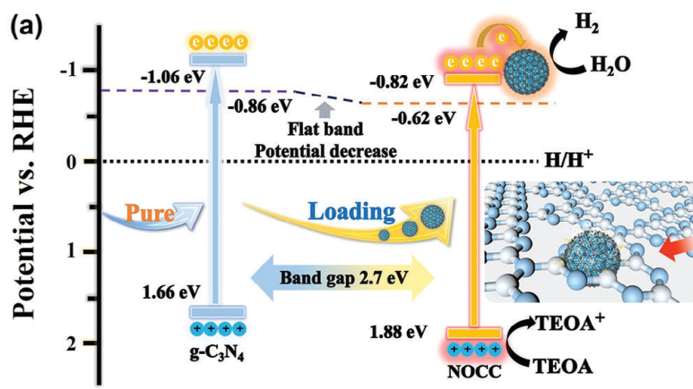

 ^fig6

Figure 6. Schematic diagrams of a) the band alignment and electron transfer in g- $C_{3}N_{4}$ and NOCC5, and b) photothermal-assisted photocatalytic hydrogen evolution with frustrated Lewis pairs (FLPs) over Ni/NiO $_{x}$ @C cocatalysts.

## 3. Conclusion

In summary, this study demonstrates the successful development and characterization of a defect-rich carbon-encapsulated Ni/NiO $_{x}$ (Ni/NiO $_{x}$ @C) cocatalyst with high-density frustrated Lewis pairs (FLPs) sites. The Jahn–Teller effect plays a vital role in facilitating the formation of high-density O (V $_{O}$ ) and Ni (V $_{Ni}$ ) vacancy sites, thereby enhancing catalytic activity. The synergistic interplay between FLP-V $_{O}$ -C basic sites and FLP-V $_{Ni}$ -C acidic sites effectively reduces energy barriers associated with water adsorption and splitting processes. Significant photothermal effects resulting from nonradiative recombination contribute to the superior performance of Ni/NiO $_{x}$ @C in photothermal-assisted photocatalytic hydrogen production. The remarkable activity of the Ni/NiO $_{x}$ @C/g-C $_{3}$ N $_{4}$ composite photocatalyst in hydrogen production surpasses that of conventional Pt cocatalyst. This work has the potential to pave the way for designing novel defect-state multiphase cocatalysts with high-density and adjacent FLP sites, thereby enhancing various catalytic reactions.

## Supporting Information

Supporting Information is available from the Wiley Online Library or from the author.

## Acknowledgements

Z.Y. and T.H. contributed equally to this work. This research was supported by National Natural Science Foundation of China (22078118, 21972048, 22274059, 51974158, and 500220086), Guangdong Laboratory of Lingnan Modern Agriculture Project (NZ2021029), and Natural Science Foundation of Guangdong Province (2023A1515010740 and 2023A1515030131). The authors thank the BL02B and 03U in the Shanghai Synchrotron Radiation Facility (SSRF) for help with characterizations.

Open access publishing facilitated by Griffith University, as part of the Wiley - Griffith University agreement via the Council of Australian University Librarians.

## Conflict of Interest

The authors declare no conflict of interest.

## Data Availability Statement

The data that support the findings of this study are available in the supplementary material of this article.

## Keywords

frustrated Lewis pairs, hydrogen production, Ni/NiO $_{x}$ @C, photocatalysis, photothermal

Received: December 11, 2023
Revised: March 3, 2024
Published online: March 17, 2024

[1] a) P. V. Kamat, K. Sivula, ACS Energy Lett. 2022, 7, 3149; b) X. Wang, K. Maeda, A. Thomas, K. Takanabe, G. Xin, J. M. Carlsson, K. Domen, M. Antonietti, Nat. Mater. 2009, 8, 76.

ADVANCED
SCIENCE NEWS \_\_\_\_
www.advancedsciencenews.com

15214095, 2024, 24, Downloaded from https://advanced.onlinelibrary.wiley.com/doi/10.1002/adma.202313513 by Sen Wu, Wiley Online Library on [17/10/2026]. See the Terms and Conditions (https://onlinelibrary.wiley.com/terms-and-conditions) on Wiley Online Library for rules of use; OA articles are governed by the applicable Creative Commons License

© 2024 The Authors. Advanced Materials published by Wiley-VCH GmbH

[2] A. K. Singh, C. Das, A. Indra, Coord. Chem. Rev. 2022, 465, 214516.

[3] Y. Li, L. Yang, H. He, L. Sun, H. Wang, X. Fang, Y. Zhao, D. Zheng, Y. Qi, Z. Li, Nat. Commun. 2022, 13, 1355.

[4] S. Chen, Z. Yang, J. Chen, J. Liao, S. Yang, F. Peng, L.-X. Ding, G. Yang, S. Zhang, Y. Fang, Chem. Eng. J. 2022, 434, 134673.

[5] L. J. Fang, X. L. Wang, Y. H. Li, P. F. Liu, Y. L. Wang, H. D. Zeng, H. G. Yang, Appl. Catal., B. 2017, 200, 578.

[6] Z. Yang, M. Li, S. Chen, S. Yang, F. Peng, J. Liao, Y. Fang, S. Zhang, S. Zhang, Adv. Funct. Mater. 2023, 33, 2212746.

[7] a) D. Liu, T. Ding, L. Wang, H. Zhang, L. Xu, B. Pang, X. Liu, H. Wang, J. Wang, K. Wu, T. Yao, Nat. Commun. 2023, 14, 1720; b) Y. Yan, J. Lin, T. Xu, B. Liu, K. Huang, L. Qiao, S. Liu, J. Cao, S. C. Jun, Y. Yamauchi, J. Qi, Adv. Energy Mater. 2022, 12, 202200434.

[8] a) S. Bai, N. Zhang, C. Gao, Y. Xiong, Nano Energy. 2018, 53, 296; b) X. Yang, J. Cui, X. Liu, Q. Zhang, D. Wang, J. Ye, L. Liu, Appl. Catal., B. 2023, 325, 122369.

[9] a) D. W. Stephan, Science. 2016, 354, aaf7229; b) D. W. Stephan, J. Am. Chem. Soc. 2021, 143, 20002.

[10] Y. X. Liu, H. H. Wang, T. J. Zhao, B. Zhang, H. Su, Z. H. Xue, X. H. Li, J. S. Chen, J. Am. Chem. Soc. 2019, 141, 38.

[11] L. Li, W. Liu, R. Chen, S. Shang, X. Zhang, H. Wang, H. Zhang, B. Ye, Y. Xie, Angew. Chem., Int. Ed. 2022, 61, 202214490.

[12] L. He, T. E. Wood, B. Wu, Y. Dong, L. B. Hoch, L. M. Reyes, D. Wang, C. Kubel, C. Qian, J. Jia, K. Liao, P. G. O'Brien, A. Sandhel, J. Y. Loh, P. Szymanski, N. P. Kherani, T. C. Sum, C. A. Mims, G. A. Ozin, ACS Nano. 2016, 10, 5578.

[13] a) W. Shockley, W. T. Read, Phys. Rev. 1952, 87, 835; b) W. S. Pelouch, R. J. Ellingson, P. E. Powers, C. L. Tang, D. M. Szmyd, A. J. Nozik, Phys. Rev. B. 1992, 45, 1450; c) C. L. Armstrong, M. B. Price, D. Munoz-Rojas, N. J. Davis, M. Abdi-Jalebi, R. H. Friend, N. C. Greenham, J. L. MacManus-Driscoll, M. L. Bohm, K. P. Musselman, ACS Nano. 2015, 9, 11863; d) Y. Tian, F. P. Garcia de Arquer, C. T. Dinh, G. Favraud, M. Bonifazi, J. Li, M. Liu, X. Zhang, X. Zheng, M. G. Kibria, S. Hoogland, D. Sinton, E. H. Sargent, A. Fratalocchi, Adv. Mater. 2017, 29, 1701165.

[14] a) Y. Cheng, Y. Chang, Y. Feng, H. Jian, Z. Tang, H. Zhang, Angew. Chem., Int. Ed. 2018, 57, 246; b) S. Zhu, S. Xu, Y. Guo, H. Zhang, K. Ma, J. Wang, Q. Zhao, L. Zhou, W. Cai, ACS Nano. 2023, 17, 10300; c) B. Tan, M. Sun, B. Liu, X. Jiang, Q. Feng, E. Xie, P. Xi, Z. Zhang, Nano Energy. 2023, 107, 108138.

[15] B. Su, Y. Kong, S. Wang, S. Zuo, W. Lin, Y. Fang, Y. Hou, G. Zhang, H. Zhang, X. Wang, J. Am. Chem. Soc. 2023, 145, 27415.

[16] D. Gao, J. Xu, L. Wang, B. Zhu, H. Yu, J. Yu, Adv. Mater. 2022, 34, 2108475.

[17] a) T. Kou, M. Chen, F. Wu, T. J. Smart, S. Wang, Y. Wu, Y. Zhang, S. Li, S. Lall, Z. Zhang, Y. S. Liu, J. Guo, G. Wang, Y. Ping, Y. Li, Nat. Commun. 2020, 11, 590; b) G. A. Gehring, K. A. Gehring, Rep. Prog. Phys. 1975, 38, 1.

[18] Y. Yang, Y. Huang, S. Zhou, Y. Liu, L. Shi, T. T. Isimjan, X. Yang, J. Energy Chem. 2022, 72, 395.

[19] a) P. Zhang, G. Zeng, T. Song, S. Huang, T. Wang, H. Zeng, J. Catal. 2019, 369, 267; b) D. Rosenthal, M. Ruta, R. Schlögl, L. Kiwi-Minsker, Carbon. 2010, 48, 1835; c) W. Qi, W. Liu, B. Zhang, X. Gu, X. Guo, D. Su, Angew. Chem., Int. Ed. 2013, 52, 14224.

[20] Z. Huang, Y. Zhang, H. Dai, Y. Wang, C. Qin, W. Chen, Y. Zhou, S. Yuan, J. Catal. 2019, 378, 331.

[21] S. Chen, J. Liao, Z. Zhou, S. Yang, Q. Gao, X. Cai, F. Peng, Y. Fang, S. Zhang, Appl. Catal., B. 2021, 291, 120139.

[22] G. Xie, X. Liu, B. Guo, T. Tan, J. R. Gong, Adv. Mater. 2023, 2211008.

[23] E. Pastor, M. Sachs, S. Selim, J. R. Durrant, A. A. Bakulin, A. Walsh, Nat. Rev. Mater. 2022, 7, 503.

[24] F. Zhang, Y. Zhu, C. Tang, Y. Chen, B. Qian, Z. Hu, Y.-C. Chang, C.-W. Pao, Q. Lin, S. A. Kazemi, Y. Wang, L. Zhang, X. Zhang, H. Wang, Adv. Funct. Mater. 2022, 32, 2110224.

[25] K. Khan, X. Yan, Q. Yu, S.-H. Bae, J. J. White, J. Liu, T. Liu, C. Sun, J. Kim, H.-M. Cheng, Y. Wang, B. Liu, K. Amine, X. Pan, Z. Luo, Nano Energy. 2021, 90, 106488.

[26] W. He, J. Yu, X. Zhang, Y. Zhou, Y. Yao, C. Ma, C. Yin, W. Yan, Y. Liu, C. Lu, X. Li, Appl. Catal., B. 2023, 331, 122738.

[27] Y. Yan, J. Lin, T. Xu, B. Liu, K. Huang, L. Qiao, S. Liu, J. Cao, S. C. Jun, Y. Yamauchi, J. Qi, Adv. Energy Mater. 2022, 12, 2200434.

[28] a) S. Cao, B. Shen, T. Tong, J. Fu, J. Yu, Adv. Funct. Mater. 2018, 28, 1800136; b) M. Tan, Y. Ma, C. Yu, Q. Luan, J. Li, C. Liu, W. Dong, Y. Su, L. Qiao, L. Gao, Q. Lu, Y. Bai, Adv. Funct. Mater. 2022, 32, 2111740; c) S. Wang, Y. Wang, S. L. Zhang, S. Q. Zang, X. W. Lou, Adv. Mater. 2019, 31, 1903404; d) M.-Q. Yang, Y.-J. Xu, W. Lu, K. Zeng, H. Zhu, Q.-H. Xu, G. W. Ho, Nat. Commun. 2017, 8, 14224.

[29] Y. Guo, L. Mao, Y. Tang, Q. Shang, X. Cai, J. Zhang, H. Hu, X. Tan, L. Liu, H. Wang, T. Yu, J. Ye, Nano Energy. 2022, 95, 107028.

[30] Y. Zhong, S. Yang, X. Cai, S. Zhang, Q. Gao, Y. Liu, Z. Yang, S. Yang, Y. Fang, Appl. Catal., B. 2020, 263, 117587.

[31] J. F. Guayaquil-Sosa, B. Serrano-Rosales, P. J. Valadés-Pelayo, H. de Lasa, Appl. Catal., B. 2017, 211, 337.

[32] H. Xu, R. Xiao, J. Huang, Y. Jiang, C. Zhao, X. Yang, Chin. J. Catal. 2021, 42, 107.

[33] L. Li, P. A. Salvador, G. S. Rohrer, Nanoscale. 2014, 6, 24.

15214095, 2024, 24, Downloaded from https://advanced.onlinelibrary.wiley.com/doi/10.1002/adma.202313513 by Sen Wu, Wiley Online Library on [17/10/2026]. See the Terms and Conditions (https://onlinelibrary.wiley.com/terms-and-conditions) on Wiley Online Library for rules of use; OA articles are governed by the applicable Creative Commons License

© 2024 The Authors. Advanced Materials published by Wiley-VCH GmbH
